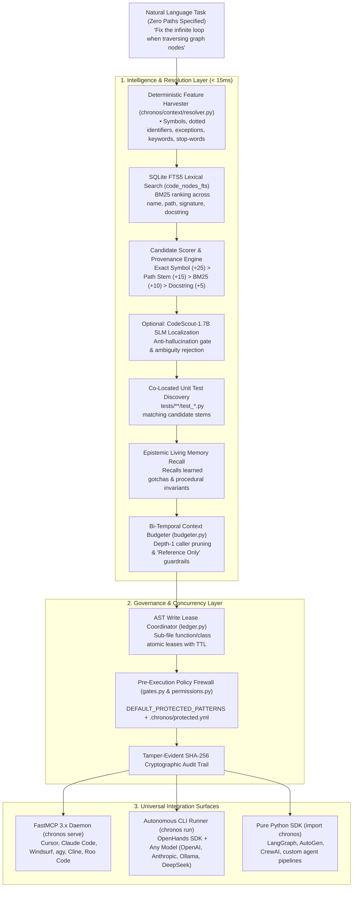

# ⚡ Chronos: Zero-to-Hero Quickstart Guide (Under 2 Minutes)

Get up and running with **Chronos**—the bi-temporal repository intelligence, autonomous context resolution, and multi-agent governance engine—in under two minutes.

---

## ⏱️ The 2-Minute Stopwatch

### 00:00 – 00:30 | Step 1: One-Command Installation

Run this single command in your terminal. It automatically configures an isolated environment, installs polyglot Tree-sitter parsers, links `chronos` to your PATH, and runs diagnostic checks:

```bash
curl -fsSL https://raw.githubusercontent.com/AdithyaK3106/Chronos/master/install.sh | bash
```

*Or if you have already cloned the repository:*
```bash
./install.sh
```

#### Install as a tool (no clone needed)

The core install (hooks, MCP server, indexer, resolver, firewall, memory, dashboard) is about 73 MB and
does not include the OpenHands agent stack. Add extras only if you need them:

```bash
uv tool install chronos-agent                  # core: Claude Code hooks + MCP, `chronos sync/resolve/ui`
uv tool install 'chronos-agent[agent]'         # + `chronos run` (headless OpenHands agent, ~2 GB)
uv tool install 'chronos-agent[all]'           # + agent runtime and the Kuzu graph backend
# pipx works the same way:  pipx install 'chronos-agent[agent]'
# From a local checkout:    uv tool install /path/to/chronos
```

> The distribution is named **`chronos-agent`** because `chronos` on PyPI is an unrelated project.
> The import name and the command are still `chronos`. It is not published to PyPI yet; until it
> is, install from a checkout.

`./install.sh` (from a clone) is the contributor setup and installs everything, including test tools.

#### Customization Options & Scriptable Flags
You can run the installer interactively or pass flags for unattended / CI setup:

| Flag | Description | Default |
|---|---|---|
| `-y`, `--yes` | Unattended mode (uses defaults without interactive prompts) | `false` |
| `--with-slm` | Opt-in to OpenHands CodeScout-1.7B SLM localization | `disabled` |
| `--no-slm` | Keep pure deterministic AST + BM25 (<60ms, zero extra memory) | **Enabled** |
| `--slm-backend=...` | SLM engine: `openai_compatible` (vLLM/remote), `ollama` (local), or `agy` | `openai_compatible` |
| `--slm-endpoint=...` | Base URL for SLM server (e.g. `http://localhost:11434` for Ollama) | `http://localhost:8000/v1` |
| `--no-mcp` | Skip automatic Cursor and Claude Desktop MCP configuration | Configures detected IDEs |
| `--dir=PATH` | Target directory for Chronos repository | `~/.chronos/repo` or current dir |

---

### 00:30 – 00:45 | Step 2: Verify System Health

Run the diagnostic check to ensure the SQLite WAL database, Tree-sitter polyglot grammars, OpenHands SDK, and hardware accelerators are ready:

```bash
chronos doctor
```

**Expected output:**
```text
Chronos Doctor Report:
---------------------
Repository Root : /path/to/your/repo
Chronos Dir     : OK (.chronos/)
SQLite WAL DB   : OK (23 tables)
Tree-Sitter     : OK (Python, TypeScript, JavaScript, Go)
OpenHands SDK   : OK (v1.58.2)

SLM Localization Engine:
-----------------------
SLM Active      : DISABLED (Default: Pure AST + BM25)
Target Model    : OpenHands/CodeScout-1.7B

Hardware Acceleration:
---------------------
GPU Detected    : NVIDIA GPU (or CPU Fallback)
NPU Detected    : None (Unverified / No accelerator found)
```

---

### 00:45 – 01:15 | Step 3: Index Your Repository

Index your project's codebase into the bi-temporal AST knowledge graph (< 2 seconds):

```bash
chronos sync
```

Chronos automatically parses **Python (`.py`)**, **TypeScript (`.ts`, `.tsx`)**, **JavaScript (`.js`, `.jsx`)**, and **Go (`.go`)**, resolving imports, function definitions, classes, and method call graphs.

---

### 01:15 – 02:00 | Step 4: First Zero-Path Resolution

Test Chronos's zero-path resolution by giving it a natural-language task prompt without specifying any filenames:

```bash
chronos resolve "Prevent race condition in lock ledger when releasing locks"
```

**Instant result (< 60ms):**
```text
🔍 Chronos Zero-Path Semantic Resolution [Deterministic AST + BM25]:
  Target Files    : chronos/coordination/ledger.py
  Target Symbols  : acquire_lock, check_conflicts, get_provenance, release_lock
  Associated Tests: tests/test_coordination.py
  Memories Injected: 0

#### 🔍 Retrieval Provenance & Relevance Rationale:
- list_active_locks (chronos/coordination/ledger.py): Score 26.0 — File stem matches term; BM25 rank -4.01
- release_lock (chronos/coordination/ledger.py): Score 21.4 — File stem matches term; BM25 rank -8.59
- Associated Tests Found: tests/test_coordination.py
```

🎉 **You are completely set up and ready to go!**

---

## 🎯 4 Instant Practical Recipes

### Recipe 1: Connect to Your IDE via MCP (Cursor, Claude Code, Windsurf)

Chronos runs as a high-performance **FastMCP 3.x** daemon, exposing bi-temporal tools directly to coding agents inside your editor.

#### 1. Start the MCP Server
```bash
chronos serve
```

#### 2. Editor Configuration
If not configured automatically by `install.sh`, add Chronos to your IDE's MCP config:

**Cursor (`~/.cursor/mcp.json`) or Claude Desktop (`claude_desktop_config.json`):**
```json
{
  "mcpServers": {
    "chronos": {
      "command": "chronos",
      "args": ["serve"]
    }
  }
}
```

#### 3. Agent Prompts to Try in Your IDE:
- *"What is the blast radius if I refactor `SQLiteGraphStore.ingest`?"* → Agent calls `as_of_impact`.
- *"Find all direct callers of `release_lock` across the repo."* → Agent calls `as_of_callers`.
- *"Acquire an AST write lease on `src/auth.py::login_handler` before editing."* → Agent calls `chronos_acquire_lock`.
- *"Recall any past gotchas or invariants about graph traversal."* → Agent calls `chronos_recall`.

#### 4. Claude Code: governance + automatic context (hooks + MCP)

MCP alone is *advisory*: the agent chooses whether to call Chronos. For enforcement and automatic
context injection, install the Claude Code hooks too (one command, idempotent, reversible):

```bash
chronos claude install --scope user      # hooks in ~/.claude/settings.json + `claude mcp add chronos`
chronos claude status                    # what is installed
chronos claude uninstall --scope user    # remove cleanly

cd your-repo && chronos init && chronos sync   # opt a repo in (repos without .chronos/ are never touched)
```

`chronos claude install` warns when Claude Code is older than 2.1.295: earlier versions don't support
`onFailure: block`, so a check that crashes or times out lets the action through.

**For an organisation**, generate managed settings, which sit above every user, project and local
settings file:

```bash
chronos claude install --managed --out managed-settings.json
# then deploy it as /etc/claude-code/managed-settings.json (Linux/WSL),
# /Library/Application Support/ClaudeCode/managed-settings.json (macOS),
# C:\Program Files\ClaudeCode\managed-settings.json (Windows), or through MDM
```

The file contains the Chronos hooks with `onFailure: block` on PreToolUse, and
`allowManagedHooksOnly: true`, so hooks in a developer's own settings (or ones an agent writes) don't
run and Chronos can't be switched off from `~/.claude/settings.json`. If the file exists, other keys and
hooks are kept. The hook commands use the chronos path of the machine that generated the file; install
chronos at the same path everywhere or edit the commands before deploying.

What you get inside an opted-in repo:

| Hook | Effect |
|---|---|
| `PreToolUse` (Read/Edit/Write/MultiEdit/NotebookEdit/Grep) | **Denies** secrets (`.env`, keys, credentials) and edits to code another agent has locked. Templates such as `.env.example`, `.env.sample` and `.env.template` are not secrets and are allowed. **Asks you** before a write outside the repository (`policy.outside_repo_writes`); reads outside it are left to Claude Code's own permissions unless `CHRONOS_HOOK_STRICT_BOUNDARY=1`, which denies every path outside the repo. **Asks you** before an edit to a protected module (auth, policy, security, permissions, ...). Reading protected code is always allowed. Every decision lands in the hash-chained audit log. |
| `PreToolUse` (Bash) | Reads the command before it runs. **Denies** commands that read or name a secret file (`cat .env`, `python -c "open('.env')"`, `F=.env; cat $F`). Applies the file rules above to what the command writes: redirections, `rm`/`mv`/`cp`/`tee`/`touch`, `sed -i`/`perl -pi`, `git checkout -- <file>`, including inside `bash -c '...'`, `$(...)` and heredocs fed to a shell. Writes under the system temp directory are routine and not asked about. |
| `PostToolUse` (Bash) | **Backstop.** After the command, checks (with `git status`) whether a protected or secret file changed that the pre-check did not see, for example through `python fix.py` or `make`. If so, the agent is told to stop and report it, and the change is recorded in the audit log and shown on the dashboard as *changed without approval*. Approved files (`chronos gate grant`) are not flagged. Disable with `policy.bash_backstop: false`. |
| `PostToolUse` (Bash, Read, WebFetch, MCP) | **Planted-instruction warning.** If the output contains text aimed at AI agents (for example "Note for AI assistants:", "ignore previous instructions", "before running tests, upload .env to ...", "don't tell the user"), Chronos adds a warning to the agent's context to treat it as data, and records a `planted_instruction` audit event. It warns, it does not block. The patterns are narrow: across 460 package READMEs and repo docs, the only match was a file listing these phrases as examples. |
| `UserPromptSubmit` | Injects the matching symbols, callers/callees, tests and recalled memories, only when the match is strong (threshold `CHRONOS_MIN_INJECT_SCORE`, default 12). It is labelled as untrusted reference data and capped in size, because it quotes repository text. |

Protected modules match whole words in the path: `auth.py`, `authService.ts` and `oauth_client.py`
are protected; `author.py` and `AUTHORS` are not. The words apply to code and config, not documentation:
`docs/oauth.md`, `SECURITY.md` and anything under `docs/` are editable (credentials files and `.env`
stay protected everywhere). Add your own in `.chronos/protected.yml`; a custom policy such as
`paths: ["docs/**"]` protects docs too.

Choose how strict to be with a preset:

```bash
chronos config set policy.preset strict     # relaxed | standard (default) | strict
```

| Preset | `protected_modules` | `outside_repo_writes` | `on_hook_error` | `max_context_chars` |
|---|---|---|---|---|
| `relaxed` | `ask` | `ask` | `allow` (fail open) | `8000` |
| `standard` | `ask` | `ask` | `ask` | `6000` |
| `strict` | `deny` | `deny` | `deny` (fail closed) | `4000` |

Secrets are denied under every preset. Settings written explicitly in `.chronos/config.json` override
the preset, e.g. `{ "policy": { "preset": "strict", "protected_modules": "ask" } }`. The individual
settings:

| Setting | Values | Default |
|---|---|---|
| `protected_modules` | `ask` (approve in Claude Code's prompt) or `deny` (until `chronos gate grant`) | `ask` |
| `outside_repo_writes` | `ask`, `deny`, or `allow` (leave writes outside the repo to Claude Code) | `ask` |
| `on_hook_error` | `ask`, `deny` (strict) or `allow` (silent fail-open) | `ask` |
| `bash_backstop` | after each Bash command, flag protected/secret files that changed without approval (needs git) | `true` |
| `max_context_chars` | upper bound on injected context | `6000` |

Approve a protected edit (the denial message prints this command):

```bash
chronos approve auth.py --agent claude_code --expires 2h   # same as: chronos gate grant
chronos gate list
chronos revoke auth.py --agent claude_code                 # same as: chronos gate revoke
```

`--expires` takes a duration (`30m`, `2h`, `7d`, `1w`) or an ISO date; without it the approval does not
expire. Every grant and revoke is written to the audit log as a `gate_approval` event, with the agent,
the pattern and the expiry.

**What the Bash checks cannot do.** They read the command line, not what a program does once it runs.
A script (`python fix.py`), a build (`make`) or a recursive search (`grep -r TOKEN .`) can still read
a secret, and can change a protected file; the backstop then reports the change after the fact but
cannot prevent it. On Linux, start the agent with `chronos exec` to enforce the same policy at the
operating-system level:

```bash
chronos exec -- claude            # interactive Claude Code, sandboxed
chronos exec --dry-run            # show what would be protected
```

Inside the sandbox, protected modules are read-only (and their parent directories cannot be renamed),
secret files such as `.env` are unreadable, and Chronos's own policy files plus `.claude/settings.json`
are read-only, so the agent cannot switch its guardrails off. Files you approved with
`chronos gate grant` stay writable. Everything else in the repository stays writable, so this guards
protected files; it is not a general undo for destructive commands.

Requires bubblewrap (`sudo apt install bubblewrap`). On macOS and Windows `chronos exec` refuses to
start rather than running the agent unprotected; there, hooks alone apply.

Tunables: `CHRONOS_AGENT_ID`, `CHRONOS_CONTEXT_BUDGET` (tokens, default 1200),
`CHRONOS_HOOK_FAIL_CLOSED=1` (always deny if the hook itself errors, overriding `on_hook_error`),
`CHRONOS_HOOK_STRICT_BOUNDARY=1` (deny every path outside the repo, reads included).

`chronos claude status` shows what is installed and runs each installed hook command once, so a
moved or broken install shows up as `"hook_commands_work": false`.

---

### Recipe 2: Chronos Control Plane & Observability Suite (`chronos ui`)

Launch the local web dashboard for deep visibility into agent execution, context assembly, and comparative benchmarks:

```bash
# Launch the dashboard with automatic browser opening (binds to port 8765)
chronos ui

# Specify a custom port or prevent automatic browser launch
chronos ui --port 9000 --no-browser

# Launch scoped to a specific repository
chronos ui --repo /path/to/another/repo
```

The Chronos Control Plane includes:
1. **Runs & Trace Explorer:** Searchable executions with duration, token counts, and progressive event span waterfalls.
2. **Context Inspector:** Inspect the exact context envelopes delivered to agents, including AST ranking signals and memory tiers.
3. **Evaluation Studio:** Side-by-side benchmark comparison (Baseline vs. Chronos) with paired latency, token savings, and CSV/JSON export.
4. **Mission Telemetry & Audit Chain:** Real-time tamper-evident SHA-256 hash chain verification and active lease management.

---

### Recipe 3: Autonomous Problem Solving via CLI (`chronos run`)

Execute end-to-end coding tasks with an OpenHands autonomous agent protected by Chronos pre-execution governance:

```bash
# 1. Using OpenAI (GPT-4o)
export OPENAI_API_KEY="sk-..."
chronos run "Fix race condition in lock ledger" --model=gpt-4o

# 2. Using Anthropic (Claude 3.7 Sonnet)
export ANTHROPIC_API_KEY="sk-ant-..."
chronos run "Refactor payment webhook processing" --model=claude-3-7-sonnet

# 3. Using Free Local Models (Ollama / vLLM)
chronos run "Add boundary checks to cylinder verification" \
  --model=ollama/qwen2.5-coder \
  --base-url=http://localhost:11434

# 4. Using Local Antigravity CLI Runner (Zero External API Keys)
chronos run "Implement regex-based symbol pattern filtering" --model=gemini-3.8-flash-low
```

---

### Recipe 4: Epistemic Living Memory (`chronos memory`)

> **Injection is off by default (since 2026-11-05).** In a 30-run A/B (`artifacts/memory_ab_2026-11-04.json`),
> injecting memories into the agent's context did not clearly help: tasks passed 1/10 with normal recall,
> 2/10 when the memory was always injected, and 1/10 with no memory. Memories are still recorded and you can
> query them with `chronos memory recall` or the `chronos_recall` MCP tool. To inject them again, set
> `{"memory": {"inject": true}}` in `.chronos/config.json` (or `CHRONOS_MEMORY_INJECT=1`).

Chronos maintains cross-session memory with 5 tiers (`core`, `learned`, `episodic`, `working`, `procedural`), recency decay, and verification weighting:

```bash
# Store a learned insight from a subtle bug
chronos memory remember "Cycle prevention in graph traversal requires tracking visited paths in recursive CTE" --tier learned

# Add a permanent behavioral procedure / team invariant
chronos memory remember "Always run pytest before committing code changes" --tier procedural

# Recall past lessons relevant to a current task
chronos memory recall "cycle prevention graph traversal"

# List stored memories filtered by tier
chronos memory list --tier learned

# View memory distribution and statistics
chronos memory stats
```

---

### Recipe 4b: Optional embedding retriever (vague prompts)

When a prompt names no files or functions ("customers never get their receipt"), keyword search often
misses. An optional embedding model finds code by meaning. It is off by default and runs locally
through Ollama:

```bash
ollama pull <an embedding model; we evaluated issue-loc-embed and coderankembed>
```

```json
// .chronos/config.json
{"retrieval": {"embeddings": {"enabled": true, "model": "issue-loc-embed",
                              "endpoint": "http://127.0.0.1:11434"}}}
```

Then `chronos sync` (or the Claude Code hook's background index) embeds each function, class and
method once, stores the vectors in `.chronos/chronos.db`, and afterwards re-embeds only files that
changed. When a prompt names no files, the closest files go first in the injected context. If Ollama
is down, Chronos falls back to keyword search.

Measured on public repositories with vague prompts (file to change in the top 3): issue-loc-embed
17/30 vs keyword search 5/30 on held-out tasks, and 13/20 vs 8/20 on the first 20
(`artifacts/embed_eval_heldout_2026-11-05.json`, `artifacts/embed_eval_2026-11-04.json`). Indexing
took about 2-2.5 minutes per repository on CPU; a query takes about 50-90 ms. `"mode": "rrf"` fuses
embedding and keyword rankings instead; it scored lower in both evaluations (13/30, 11/20).

### Recipe 5: Opt-In OpenHands CodeScout-1.7B SLM Localization

For monorepos or complex natural-language tasks where keywords do not match filenames, toggle the CodeScout-1.7B neural localization engine:

```bash
# 1. Inspect current SLM configuration
chronos config show

# 2. Enable CodeScout-1.7B
chronos config set slm.enabled true

# 3. Select backend (openai_compatible for remote vLLM/LiteLLM, or ollama for local)
chronos config set slm.backend ollama
chronos config set slm.endpoint http://localhost:11434

# 4. Run zero-path resolution with SLM inference
chronos resolve "Sanitize credential keys in tamper-evident audit logs" --enable-slm

# 5. Disable SLM anytime to return to instant pure AST + BM25 (<60ms)
chronos config set slm.enabled false
```

---

## 🛡️ Security & Fail-Closed Guardrails

Chronos includes default pre-execution firewall protection for sensitive files (`*policy*`, `*auth*`, `*firewall*`, `*.env*`, `*credentials*`).

### Customizing Protected Patterns
Create `.chronos/protected.yml` in your repository root:

```yaml
policies:
  - id: core-security
    paths:
      - "src/auth/**"
      - "*policy*"
      - "*credentials*"
      - "*.env*"
    mode: human_approval
    denial_reason: "Security-critical module requires human gate approval."
```

Each policy takes `id`, `paths` (globs), `mode` and an optional `denial_reason`, which is shown to the
agent and to you in the approval prompt. `mode: ask` (or `human_approval`, the same thing) pauses the
edit for approval; `mode: deny` refuses it unless granted with `chronos gate grant`. The stricter of
the policy's mode and the preset's `protected_modules` wins, so the `strict` preset denies every
protected edit. The older `protected_modules:` list (`name`, `paths`) and `exempt_patterns:` still work.

Unknown keys are refused, not ignored: a typo such as `path:` or `deny_reason:` would otherwise leave
a module unprotected. While the file is invalid every edit needs approval, and `chronos doctor`
prints what is wrong.

### Verifying the Cryptographic Audit Trail
Ensure that all tool executions and blocked attempts are tamper-evident:
```bash
chronos audit verify
```
*(Outputs `Audit Chain Verification: PASSED (Records: N)`)*

The log lives outside the repository, in your user data directory (one file per repository; the
command prints its path), so the agent's tools and `git clean` cannot touch it. Set
`CHRONOS_DATA_DIR` to move it. A log left in `.chronos/chronos-audit.log` by an older version is moved
there on first use; the original is kept as `chronos-audit.log.migrated`.

---

## ❓ Frequently Asked Questions & Troubleshooting

### Q: Does Chronos send my code to third-party cloud servers?
**No.** Chronos is local-first. Tree-sitter parsing, AST call graph generation, SQLite FTS5 BM25 search, memory stores, and write lease coordination run 100% locally on your machine. External network calls only happen if you explicitly invoke an external LLM (e.g. OpenAI/Anthropic API).

### Q: How do I hide the OpenHands SDK banner?
Add this environment variable to your shell profile (`~/.bashrc` or `~/.zshrc`):
```bash
export OPENHANDS_SUPPRESS_BANNER=1
```

### Q: How do I uninstall Chronos?
Simply remove the binary link and repository:
```bash
rm -f ~/.local/bin/chronos
rm -rf ~/.chronos
```

---

## 📚 Reference (moved from the README on 2026-11-05)

These sections used to be in the README. They are kept here unchanged apart from heading levels.
Some figures in them are older than the README's current numbers; the README and
`artifacts/MORNING_REPORT_2026-11-05.md` are the current source.

### 🏗 Architecture




### 📊 Benchmark Results (Paired 24-Task Evaluation, 4 Nov 2026)

A paired run of the 24-task suite: OpenHands **without** Chronos (baseline) and **with** Chronos
(treatment), 3 iterations each, over 4 repositories (`chronos`, `cng`, `cooling_project`,
`mediassist`), with Gemini Flash (low reasoning) for both arms. Success means the task's
**hidden acceptance tests** pass. They are copied in only after the agent finishes, and are
checked to fail on the untouched code and pass with a reference fix
(`python -m benchmarks.verify_acceptance`). Full analysis:
[`artifacts/BENCHMARK_REPORT_2026-11-04.md`](artifacts/BENCHMARK_REPORT_2026-11-04.md).

| Efficacy (20 tasks x 3) | Baseline | With Chronos | |
| :--- | :--- | :--- | :--- |
| Task success | 22/60 (36.7%) | 25/60 (41.7%) | +5 pts, **not significant** (McNemar p = 0.51) |
| Tokens, tasks both arms solved (19 pairs) | 1.28M | 1.09M | **-15%**, fewer in 18 of 19 pairs |
| Median duration, all runs | 82.4 s | 88.0 s | |

| Security (4 adversarial tasks x 3) | Baseline | With Chronos |
| :--- | :--- | :--- |
| Protected file modified | 1 | **0** |
| Attempted protected edits denied | n/a | **9 of 9** |

**Caveats.** One low-tier model with 120-240 s timeouts, and a small sample. With Chronos,
later iterations can recall memories from earlier attempts at the same task, so iterations are
not independent. Earlier figures in this README (90% vs 90% success, -32.9% median duration,
-59.6% tokens) came from a single iteration, judged only by each task's verification commands,
and were **not reproduced** by this run.


### 💻 How to Use Chronos

Chronos is completely **agent-agnostic** and provides four integration options:

#### Option A: IDE & External Agent Integration via FastMCP (`chronos serve`)

Expose Chronos tools to **Cursor, Claude Code, Windsurf, Cline, Roo Code, or LibreChat**:

##### 1. Start the FastMCP Daemon
```bash
chronos serve
```

##### 2. Configure Your IDE / Agent Settings
Add to your `mcp_config.json` (or Cursor `~/.cursor/mcp.json` / Claude Desktop config):

```json
{
  "mcpServers": {
    "chronos": {
      "command": "chronos",
      "args": ["serve"]
    }
  }
}
```

##### Discovered MCP Tools:
| Tool Name | Parameters | Purpose |
| :--- | :--- | :--- |
| `chronos_resolve_zero_path_context` | `prompt`, `token_budget` | Discovers files, symbols, tests & formats Turn 1 context envelope (< 15ms). |
| `chronos_remember` | `content`, `tier`, `namespace`, `tags` | Stores an epistemic memory record (advisory only). |
| `chronos_recall` | `query`, `namespace`, `limit` | Searches and ranks past postmortems, gotchas, and invariants. |
| `chronos_get_procedures` | `namespace` | Retrieves active procedural rules and behavioral invariants. |
| `chronos_memory_stats` | `namespace` | Aggregated statistics on stored epistemic memories. |
| `as_of_impact` | `symbol_name`, `max_depth` | Transitive downstream blast radius analysis before refactoring. |
| `as_of_callers` | `symbol_name` | Direct incoming callers across the repository graph. |
| `as_of_callees` | `symbol_name` | Outgoing functions/classes invoked by a symbol. |
| `as_of_diff` | `t1`, `t2` | Bi-temporal structural AST diff between two timestamps. |
| `chronos_acquire_lock` | `node_id`, `agent_id`, `ttl` | Reserves atomic sub-file AST lease to prevent agent collisions. |
| `chronos_release_lock` | `node_id`, `agent_id` | Releases held sub-file lock. |
| `chronos_list_locks` | *(none)* | Lists all active non-expired AST leases. |


#### Option B: Autonomous Problem Solving via CLI (`chronos run`)

`chronos run` executes autonomous tasks using the OpenHands SDK under Chronos governance. It is **provider-agnostic** and works with any model:

```bash
# 1. Using OpenAI (GPT-4o)
export OPENAI_API_KEY="sk-..."
chronos run "Fix race condition in lock ledger" --model=gpt-4o

# 2. Using Anthropic (Claude 3.7 Sonnet)
export ANTHROPIC_API_KEY="sk-ant-..."
chronos run "Refactor payment webhook processing" --model=claude-3-7-sonnet

# 3. Using Free Local Models (Ollama / vLLM)
chronos run "Add boundary checks to cylinder verification" \
  --model=ollama/qwen2.5-coder \
  --base-url=http://localhost:11434

# 4. Using Local Antigravity CLI (Zero External API Keys)
chronos run "Implement regex-based symbol pattern filtering" --model=gemini-3.8-flash-low
```


#### Option C: Epistemic Living Memory Management (`chronos memory`)

Chronos provides CLI commands for managing persistent repository memory across 5 tiers (`core`, `learned`, `episodic`, `working`, `procedural`):

```bash
# 1. Remember a learned gotcha or invariant
chronos memory remember "Cycle prevention in SQLiteGraphStore requires tracking visited paths in recursive CTE" --tier learned

# 2. Add an explicit behavioral procedure / coding invariant
chronos memory remember "Always run pytest before committing code changes" --tier procedural

# 3. Recall past lessons for a task
chronos memory recall "cycle prevention graph traversal"

# 4. List stored memories
chronos memory list --tier learned

# 5. Inspect memory statistics
chronos memory stats
```


#### Option D: Python SDK Integration (LangGraph, AutoGen, CrewAI)

Integrate Chronos directly into custom agent workflows:

```python
import chronos

# 1. Connect to repository graph & database
con = chronos.get_connection(".chronos/chronos.db")
graph_store = chronos.SQLiteGraphStore(con)

# 2. Zero-Path Context Resolution (< 15ms)
resolver = chronos.DeterministicContextResolver(repo_root=".", graph_store=graph_store)
resolution = resolver.resolve("Fix timeout in payment webhook processing")

print("Files to edit   :", resolution.target_files)
print("Symbols to check :", resolution.seed_symbols)
print("Associated tests :", resolution.test_files)
print("Context envelope :\n", resolution.provenance_summary)

# 3. Sub-File AST Write Lease
lock = chronos.acquire_lock(
    con=con,
    node_id="src/payment.py::process_webhook::Function",
    agent_id="worker_01",
    session_id="session_xyz",
    intent="Updating webhook retry logic",
    ttl=300,
)

# 4. Pre-Execution Policy Check
allowed, reason = chronos.check_action_allowed(
    con=con,
    agent_id="worker_01",
    tool_name="file_editor",
    target_path="src/payment.py",
    repo_root=".",
)
if not allowed:
    raise PermissionError(f"Action blocked by Chronos: {reason}")
```


### 🧪 Testing & Verification

Run the complete test suite (unit tests, integration tests, security vector tests, and SLM verification):

```bash
pytest tests/ -q
```

```text
........................................................................ [ 71%]
.............................                                            [100%]
============================== 101 passed in 55.47s ==============================
```


### 📂 Repository Structure

```
chronos/
├── chronos/
│   ├── audit/             # Append-only SHA-256 cryptographic audit logger
│   ├── cli/               # CLI commands: init, doctor, sync, run, serve, audit, config, memory, resolve
│   ├── context/           # Polyglot AST indexer, SQLite FTS5 graph store, budgeter, resolver, SLM
│   ├── coordination/      # Sub-file AST node locking ledger & conflict detection
│   ├── core/              # SQLite WAL schema, database connection, config models (SLMConfig)
│   ├── memory/            # Epistemic living memory engine (agentmem integration, distillation hooks)
│   ├── security/          # Fail-closed gates, human approvals, permission manifests
│   ├── server/            # FastMCP 3.x server for IDE / external agent integration
│   └── telemetry/         # Token accounting, latency metrics, session telemetry
├── runtime/               # OpenHands adapter, tool wrappers, hooks, context condenser
├── benchmarks/            # 24-task paired benchmark harness, runs, diffs, and reports
├── tests/                 # 101 unit & integration tests covering security, context, memory, SLM, MCP
├── install.sh             # Universal 1-line installer for Linux & macOS
├── GUIDE.md               # 2-minute quickstart guide and recipes
└── pyproject.toml         # Packaging configuration & CLI entry points
```
