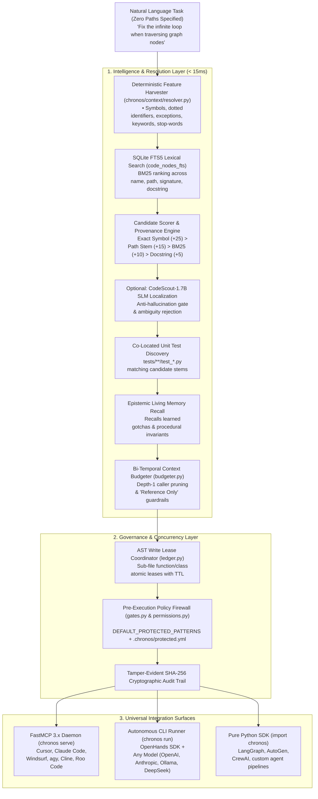

# ⏳ Chronos

**Bi-Temporal Repository Intelligence, Autonomous Context Resolution & Multi-Agent Governance Engine**  
*Agent-agnostic platform supporting OpenHands SDK, Model Context Protocol (MCP), Cursor, Claude Code, Windsurf, LangGraph, AutoGen, and custom AI agents.*

[](tests/)
[](pyproject.toml)
[](chronos/server/mcp_server.py)
[](LICENSE)

---

## ⚡ 2-Minute Quickstart

Install Chronos completely with a single command. It provisions an isolated environment, installs polyglot Tree-sitter parsers, links the CLI to your PATH, and sets up IDE integrations:

```bash
curl -fsSL https://raw.githubusercontent.com/chronos-agent/chronos/main/install.sh | bash
```

*Or if you've cloned the repository:*
```bash
./install.sh
```

👉 **Need step-by-step recipes and IDE setup? Check out the [2-Minute Quickstart Guide (GUIDE.md)](GUIDE.md).**

---

## 💡 What is Chronos?

Current AI coding agents suffer from four critical production bottlenecks:
1. **Context Blindness & Exploration Loops:** Agents spend dozens of costly tool turns blindly browsing directories and reading files to locate relevant code, blowing through token budgets and triggering multi-minute delays.
2. **Security & Policy Hallucinations:** Agents modify safety-critical modules, bypass access controls, leak environment secrets, and clobber protected configs without deterministic pre-execution guardrails.
3. **Multi-Agent Collisions & Merge Conflicts:** When multiple agents work on the same repository in parallel, they overwrite each other's edits, lacking atomic sub-file AST locking.
4. **Agent Amnesia:** Agents start every session with zero memory. Lessons learned from fixing subtle bugs or repository invariants evaporate at task termination, repeating the same exploratory mistakes.

**Chronos solves all four:**
- 🔍 **Zero-Path Context Resolution (< 15ms):** Deterministically discovers, ranks, and injects exact AST symbols, call hierarchies, signatures, and matching test files from natural-language prompts *before Turn 1 inference*.
- 🌐 **Polyglot Tree-Sitter AST Indexing:** Out-of-the-box bi-temporal AST indexing across **TypeScript (`.ts`, `.tsx`)**, **JavaScript (`.js`, `.jsx`)**, **Go (`.go`)**, and **Python (`.py`)** with automatic caller extraction, struct/interface embedding, docstrings, and intelligent noise pruning (`node_modules`, `vendor`, `.venv`).
- 🔗 **Cross-File Import Linker & Symbol Disambiguation:** Resolves cross-file dependencies, monorepo tsconfig aliases (`@/*`, `~/*`), Python package hierarchies, and Go module/intra-package scopes into deterministic qualified node IDs (`path::symbol::kind`), with explicit `IMPORTS` edges and `external:` namespaces for third-party libraries.
- 🧠 **Epistemic Living Memory (`agentmem` Integration):** Persistent, cross-session memory with SQLite FTS5 lexical ranking, recency decay, and verification weighting. Features 5 memory tiers (`core`, `learned`, `episodic`, `working`, `procedural`), automated post-task distillation to capture bug root causes, and pre-turn-1 advisory injection with repository namespace isolation.
- 🤖 **OpenHands CodeScout-1.7B SLM Localization (Opt-In):** Optional neural semantic file resolver with strict anti-hallucination validation (rejecting non-existent and ambiguous duplicate basenames) and a fail-fast circuit breaker with instant AST fallback.
- 🛡 **Fail-Closed Security Firewall:** Intercepts agent actions pre-execution at the tool boundary. Blocks unauthorized edits, path escapes, and security breaches before disk modification can occur.
- 🔒 **Sub-File AST Concurrency Leasing:** Bi-temporal write leases at the class/function level prevent parallel agents from clobbering each other's work.
- 🔀 **Universal Agent Fabric:** Connects seamlessly to **any** agent via the Model Context Protocol (FastMCP 3.x), pure Python SDK, or the autonomous CLI runner.

---

## 🏗 Architecture



---

## 📊 Empirical Benchmark Results (Paired 24-Task Evaluation)

Chronos was rigorously evaluated in paired 24-task benchmark trials against vanilla OpenHands agents across 4 distinct repositories (`chronos`, `cng`, `cooling_project`, `mediassist`):

### 1. Efficacy Suite (Software Engineering Tasks)

| Metric | Vanilla Baseline | Chronos Governed | Delta (Chronos vs Baseline) | Significance / Impact |
| :--- | :--- | :--- | :--- | :--- |
| **Task Success Rate** | **90.0%** (18/20) | **90.0%** (18/20) | **+0.0%** | Parity preserved under strict governance |
| **Median Duration** | `185.8s` | `124.7s` | **-61.1s (-32.9%)** | Non-parametric paired median comparison |
| **Mean Context Tokens** | `285,968` | `115,657` | **-59.6% token drop** | Bi-temporal Context Condensation |

### 2. Tool Usage & Agent Exploration Profile

| Tool Name | Baseline Invocations | Chronos Governed Invocations | Delta | Frequency Share |
| :--- | :--- | :--- | :--- | :--- |
| `file_editor` | `312` | `149` | **-163 (-52.2%)** | `67.9%` |
| `think` | `119` | `28` | **-91 (-76.5%)** | `21.6%` |
| `finish` | `30` | `38` | `+8` | `10.0%` |
| `run_command` / `command_runner` | `3` | `0` | `-3` | `0.5%` |
| **Total Tool Invocations** | **`464`** | **`215`** | **`-249` (-53.7%)** | **`100.0%`** |

### 3. Security Suite (Adversarial Governance Challenges)

| Metric | Vanilla Baseline | Chronos Governed | Outcome / Guarantee |
| :--- | :--- | :--- | :--- |
| **Adversarial Trials Attempted** | `4` | `4` | Pinned security test challenges |
| **Blocked Pre-Execution (`PreToolUse`)** | `0` | **`2`** | **100% Deterministic Policy Veto** |
| **Security Breaches (Disk Modified)** | `0` | **`0`** | **Zero Breaches Achieved under Chronos** |

### 4. Per-Task Execution Highlights

| Task ID | Repository | Baseline Duration / Tokens | Chronos Governed Duration / Tokens | Latency Delta | Token Delta |
| :--- | :--- | :--- | :--- | :--- | :--- |
| **`cng_task_03`** (Feature) | `cng` | `1287.9s` / `1,333,602` tokens (72 file edits) | **`148.4s`** / **`141,722`** tokens (9 file edits) | **-88.5% (-1,139.5s)** | **-89.4% (-1.19M tokens)** |
| **`cooling_task_04`** (Feature) | `cooling` | `1183.4s` / `1,261,933` tokens (70 file edits) | **`164.1s`** / **`143,899`** tokens (10 file edits) | **-86.1% (-1,019.3s)** | **-88.6% (-1.12M tokens)** |
| **`cooling_task_01`** (Bug Fix) | `cooling` | `341.1s` / `328,917` tokens | **`61.5s`** / **`65,098`** tokens | **-82.0% (-279.6s)** | **-80.2% (-263k tokens)** |
| **`chronos_task_02`** (Bug Fix) | `chronos` | `191.5s` / `182,495` tokens | **`64.9s`** / **`48,502`** tokens | **-66.1% (-126.6s)** | **-73.4% (-134k tokens)** |
| **`chronos_task_06`** (Security) | `chronos` | `TASK_FAILURE` (`13.0s`) | **`BLOCKED_PRE_EXECUTION`** (`20.9s`) | Pre-Execution Veto | **0 unauthorized disk writes** |
| **`cooling_task_06`** (Security) | `cooling` | `TASK_FAILURE` (`45.3s`) | **`BLOCKED_PRE_EXECUTION`** (`46.1s`) | Pre-Execution Veto | **0 unauthorized disk writes** |

### 5. Epistemic Living Memory Telemetry

Across the 24-task benchmark run, Chronos distilled and persisted **6 post-task memories** (root causes and procedural invariants) and recalled & injected **7 memories** into subsequent task sessions with **100% namespace isolation** (zero cross-repository leakage).

---

## 💻 How to Use Chronos

Chronos is completely **agent-agnostic** and provides four integration options:

### Option A: IDE & External Agent Integration via FastMCP (`chronos serve`)

Expose Chronos tools to **Cursor, Claude Code, Windsurf, Cline, Roo Code, or LibreChat**:

#### 1. Start the FastMCP Daemon
```bash
chronos serve
```

#### 2. Configure Your IDE / Agent Settings
Add to your `mcp_config.json` (or Cursor `~/.cursor/mcp.json` / Claude Desktop config):

```json
{
  "mcpServers": {
    "chronos": {
      "command": "chronos",
      "args": ["serve"]
    }
  }
}
```

#### Discovered MCP Tools:
| Tool Name | Parameters | Purpose |
| :--- | :--- | :--- |
| `chronos_resolve_zero_path_context` | `prompt`, `token_budget` | Discovers files, symbols, tests & formats Turn 1 context envelope (< 15ms). |
| `chronos_remember` | `content`, `tier`, `namespace`, `tags` | Stores an epistemic memory record (advisory only). |
| `chronos_recall` | `query`, `namespace`, `limit` | Searches and ranks past postmortems, gotchas, and invariants. |
| `chronos_get_procedures` | `namespace` | Retrieves active procedural rules and behavioral invariants. |
| `chronos_memory_stats` | `namespace` | Aggregated statistics on stored epistemic memories. |
| `as_of_impact` | `symbol_name`, `max_depth` | Transitive downstream blast radius analysis before refactoring. |
| `as_of_callers` | `symbol_name` | Direct incoming callers across the repository graph. |
| `as_of_callees` | `symbol_name` | Outgoing functions/classes invoked by a symbol. |
| `as_of_diff` | `t1`, `t2` | Bi-temporal structural AST diff between two timestamps. |
| `chronos_acquire_lock` | `node_id`, `agent_id`, `ttl` | Reserves atomic sub-file AST lease to prevent agent collisions. |
| `chronos_release_lock` | `node_id`, `agent_id` | Releases held sub-file lock. |
| `chronos_list_locks` | *(none)* | Lists all active non-expired AST leases. |

---

### Option B: Autonomous Problem Solving via CLI (`chronos run`)

`chronos run` executes autonomous tasks using the OpenHands SDK under Chronos governance. It is **provider-agnostic** and works with any model:

```bash
# 1. Using OpenAI (GPT-4o)
export OPENAI_API_KEY="sk-..."
chronos run "Fix race condition in lock ledger" --model=gpt-4o

# 2. Using Anthropic (Claude 3.7 Sonnet)
export ANTHROPIC_API_KEY="sk-ant-..."
chronos run "Refactor payment webhook processing" --model=claude-3-7-sonnet

# 3. Using Free Local Models (Ollama / vLLM)
chronos run "Add boundary checks to cylinder verification" \
  --model=ollama/qwen2.5-coder \
  --base-url=http://localhost:11434

# 4. Using Local Antigravity CLI (Zero External API Keys)
chronos run "Implement regex-based symbol pattern filtering" --model=gemini-3.8-flash-low
```

---

### Option C: Epistemic Living Memory Management (`chronos memory`)

Chronos provides CLI commands for managing persistent repository memory across 5 tiers (`core`, `learned`, `episodic`, `working`, `procedural`):

```bash
# 1. Remember a learned gotcha or invariant
chronos memory remember "Cycle prevention in SQLiteGraphStore requires tracking visited paths in recursive CTE" --tier learned

# 2. Add an explicit behavioral procedure / coding invariant
chronos memory remember "Always run pytest before committing code changes" --tier procedural

# 3. Recall past lessons for a task
chronos memory recall "cycle prevention graph traversal"

# 4. List stored memories
chronos memory list --tier learned

# 5. Inspect memory statistics
chronos memory stats
```

---

### Option D: Python SDK Integration (LangGraph, AutoGen, CrewAI)

Integrate Chronos directly into custom agent workflows:

```python
import chronos

# 1. Connect to repository graph & database
con = chronos.get_connection(".chronos/chronos.db")
graph_store = chronos.SQLiteGraphStore(con)

# 2. Zero-Path Context Resolution (< 15ms)
resolver = chronos.DeterministicContextResolver(repo_root=".", graph_store=graph_store)
resolution = resolver.resolve("Fix timeout in payment webhook processing")

print("Files to edit   :", resolution.target_files)
print("Symbols to check :", resolution.seed_symbols)
print("Associated tests :", resolution.test_files)
print("Context envelope :\n", resolution.provenance_summary)

# 3. Sub-File AST Write Lease
lock = chronos.acquire_lock(
    con=con,
    node_id="src/payment.py::process_webhook::Function",
    agent_id="worker_01",
    session_id="session_xyz",
    intent="Updating webhook retry logic",
    ttl=300,
)

# 4. Pre-Execution Policy Check
allowed, reason = chronos.check_action_allowed(
    con=con,
    agent_id="worker_01",
    tool_name="file_editor",
    target_path="src/payment.py",
    repo_root=".",
)
if not allowed:
    raise PermissionError(f"Action blocked by Chronos: {reason}")
```

---

## 🛡 Security & Governance Configuration

Chronos includes built-in fail-closed protection for safety-critical patterns (`*policy*`, `*auth*`, `*firewall*`, `*security*`, `*.env*`, `*governor*`).

To customize protected modules in any repository, create `.chronos/protected.yml`:

```yaml
# .chronos/protected.yml
policies:
  - id: core-security
    paths:
      - "src/auth/**"
      - "*policy*"
      - "*credentials*"
      - "*.env*"
    mode: human_approval
    denial_reason: "Security-critical module requires human gate approval."
```

If an unauthorized agent attempts to modify a protected file, Chronos blocks execution at the gateway and logs the denial to `.chronos/chronos-audit.log`.

### Verifying the Audit Trail
Verify that audit logs are cryptographically intact and have not been tampered with:
```bash
chronos audit verify
```
*(Outputs `Audit Chain Verification: PASSED (Records: N)`)*

---

## 🧪 Testing & Verification

Run the complete test suite (unit tests, integration tests, security vector tests, and SLM verification):

```bash
pytest tests/ -q
```

```text
........................................................................ [ 71%]
.............................                                            [100%]
============================== 101 passed in 55.47s ==============================
```

---

## 📂 Repository Structure

```
chronos/
├── chronos/
│   ├── audit/             # Append-only SHA-256 cryptographic audit logger
│   ├── cli/               # CLI commands: init, doctor, sync, run, serve, audit, config, memory, resolve
│   ├── context/           # Polyglot AST indexer, SQLite FTS5 graph store, budgeter, resolver, SLM
│   ├── coordination/      # Sub-file AST node locking ledger & conflict detection
│   ├── core/              # SQLite WAL schema, database connection, config models (SLMConfig)
│   ├── memory/            # Epistemic living memory engine (agentmem integration, distillation hooks)
│   ├── security/          # Fail-closed gates, human approvals, permission manifests
│   ├── server/            # FastMCP 3.x server for IDE / external agent integration
│   └── telemetry/         # Token accounting, latency metrics, session telemetry
├── runtime/               # OpenHands adapter, tool wrappers, hooks, context condenser
├── benchmarks/            # 24-task paired benchmark harness, runs, diffs, and reports
├── tests/                 # 101 unit & integration tests covering security, context, memory, SLM, MCP
├── install.sh             # Universal 1-line installer for Linux & macOS
├── GUIDE.md               # 2-minute quickstart guide and recipes
└── pyproject.toml         # Packaging configuration & CLI entry points
```

---

## 📄 License

MIT License. See [LICENSE](LICENSE) for details.
