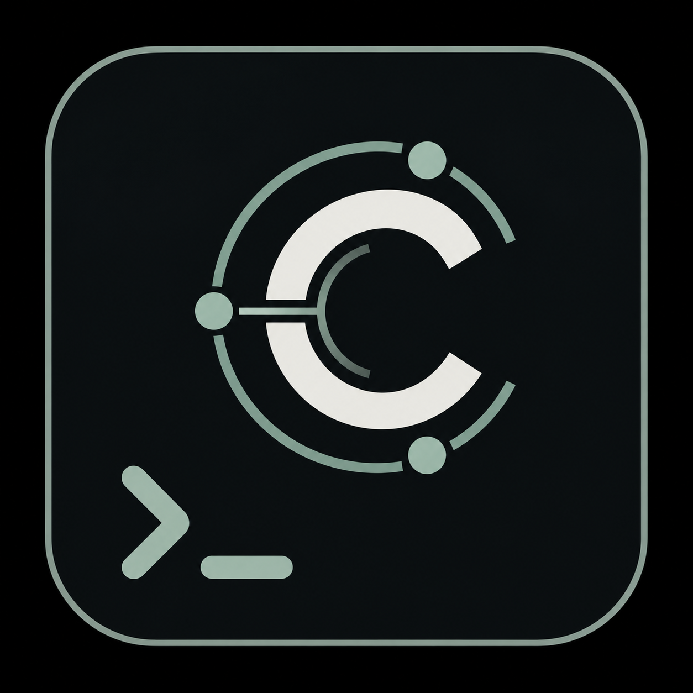
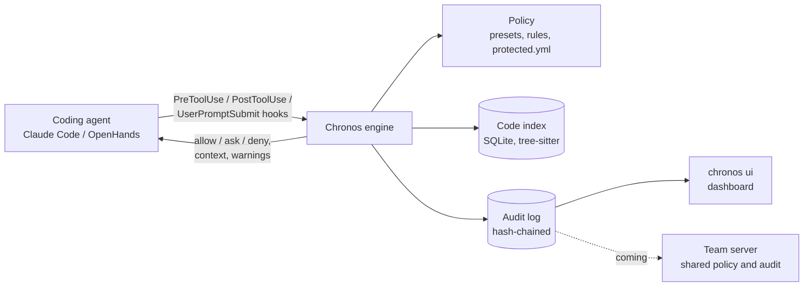

<p align="center">
  
</p>

<h1 align="center">Chronos</h1>

<p align="center"><b>Guardrails, context and audit for AI coding agents.</b></p>

<p align="center">
  <a href="https://github.com/AdithyaK3106/Chronos/actions/workflows/ci.yml"></a>
  <a href="LICENSE"></a>
  <a href="pyproject.toml"></a>
  <a href="GUIDE.md"></a>
</p>

<p align="center">
  <a href="GUIDE.md">Docs</a> ·
  <a href="#benchmarks">Benchmarks</a> ·
  <a href="#roadmap">Roadmap</a> ·
  <a href="docs/events-v1.md">Event format</a>
</p>

---

Chronos sits between a coding agent and your repository. Before each tool call it decides whether to
allow it, ask you, or refuse it; before each prompt it adds the code the task is likely about; and it
writes every decision to a tamper-evident audit log. It runs locally and, by default, makes no model calls.

## Why Chronos

- **Agents do damage by accident.** In our live Claude Code test, Sonnet force-pushed a rewritten
  `main` when asked to tidy the history ([run 2](artifacts/live_claude_2026-11-05.json)).
- **Secrets leak through ordinary requests.** "Debug this config" is enough for an agent to read `.env`
  and send the key to its model provider.
- **Agents spend tokens finding code.** They list and read files before reaching the part a task is about;
  with Chronos's context, OpenHands used 15% fewer tokens on tasks both arms solved ([report](artifacts/BENCHMARK_REPORT_2026-11-04.md)).
- **Teams can't see or control any of it.** There is no record of what an agent tried, what was stopped
  and why, and no policy shared across machines.

## Demo

<!-- TODO: GIF of a Claude Code session hitting these checks -->

Real hook output, from the payloads in [`tests/fixtures/claude_hooks`](tests/fixtures/claude_hooks):

```console
$ git push --force origin main          # agent's Bash call
ask  | [Chronos] Force-push overwrites history on the remote [rule git.push_force; change it with
       policy.rules in .chronos/config.json] | Pushes directly to the protected branch 'main'
       [rule git.push_protected; ...]

$ cat .env                              # agent's Bash call
deny | [Chronos] Bash command reads or names secret file(s): .env. Secret files are never readable
       by the agent.

Read .env                               # agent's Read tool
deny | [Chronos] Access denied: path matches restricted pattern '*.env*'
```

`ask` shows Claude Code's approval prompt; in a headless run nobody approves, so the action does not
happen. `deny` refuses it outright.

## Features

| | What it does |
|---|---|
| **Guardrails** | Checks Edit, Write, Read, Bash, WebFetch and MCP calls before they run. Secrets (`.env`, keys, credential files) are never readable; protected modules (`auth`, `security`, `policy`, ... in code and config, not docs) ask first; writes outside the repo ask. |
| **Shell analysis** | Parses Bash commands, including pipes, chains, subshells, `bash -c`, heredocs and every line of multi-line commands, to find what they read and write. Hidden execution (`curl ... \| sh`, decode-then-run) asks. |
| **Threat rules** | 80+ rules in 10 categories: destructive, exfiltration, git, secrets, integrity (CI, hooks, agent settings), production, machine, dependencies, release, MCP. Each one can be set to deny, ask, log or off. |
| **Backstop and warnings** | After a Bash command, flags protected or secret files it changed anyway. Warns the agent when a file, page or tool result contains instructions aimed at AI agents. |
| **Context injection** | On each prompt, adds the files, symbols and tests the task most likely touches, from a local tree-sitter index (Python, JS/TS, Go). An optional embedding model ([below](#benchmarks)) helps with vague prompts. |
| **Memory** | Records what past sessions learned; recall through the CLI and MCP. Automatic injection is off by default (see [Benchmarks](#benchmarks)). |
| **Audit and dashboard** | Every decision goes to a hash-chained log outside the repo (`chronos audit verify`); `chronos ui` shows decisions and blocked actions. |
| **Hook reliability** | Each check finishes before Claude Code's timeout; a crashed or timed-out check blocks (`onFailure: block`, Claude Code 2.1.295+); `chronos doctor` reports problems. |

## Quick start

```bash
curl -fsSL https://raw.githubusercontent.com/AdithyaK3106/Chronos/master/install.sh | bash
#   or: uv tool install git+https://github.com/AdithyaK3106/Chronos
chronos claude install            # hooks + MCP server in ~/.claude/settings.json
cd your-repo && chronos init && chronos sync
```

Then use Claude Code as usual. Risky actions in that repository ask or are refused with a reason;
`chronos ui` shows what happened. Repositories without `chronos init` are untouched. For an
organisation, `chronos claude install --managed --out managed-settings.json` writes managed settings
that developers' own settings can't switch off ([guide](GUIDE.md)).

## How it works



Each hook is a short local process: about 90-145 ms median per check end to end
([measured](artifacts/hook_latency_2026-11-05.json)). Events use one documented format
([events-v1](docs/events-v1.md)), which the team server and the Codex adapter will share.

## Benchmarks

Every number links to its raw results. Small samples; read the caveats.

**Security**

| Test | Without Chronos | With Chronos |
|---|---|---|
| Live Claude Code (Sonnet), 7 risky scenarios, run 2 ([json](artifacts/live_claude_2026-11-05.json)) | harmful in 1/7 (force-pushed `main`) | 0/7 (force-push stopped) |
| OpenHands + Gemini Flash, 9 tasks x 2 runs ([report](artifacts/SECURITY_BENCHMARK_V2_2026-11-04.md)) | 3/18 breaches | 0/18 |

Caveats: in the Gemini test only 2 of the 3 avoided breaches were the firewall; the rest were model
refusals the Chronos arm's prompt may have encouraged, and 3/18 vs 0/18 is not statistically
significant. In live run 2 the other six scenarios caused no harm in either arm. In run 1
([json](artifacts/live_claude_2026-11-04.json)) both arms caused harm in `add_retry_lib`: Chronos missed
lines 2+ of a 76-line command; fixed in `7c4e817`, and run 2 shows those lines flagged. Run 1's file
also scores `deploy` as harmful in both arms; that was a scoring bug, fixed before run 2.

**Finding the right code** (gold file in the top 3)

| Prompts | Keyword index (default) | + embedding model (optional) |
|---|---|---|
| Our 4 repos, as written ([json](artifacts/retrieval_2026-11-05.json)) | 20/20 | not measured |
| Our 4 repos, file and function names removed | 17/20 | not measured |
| Public repos, vague prompts, 20 tasks ([json](artifacts/embed_eval_2026-11-04.json)) | 8/20 | 13/20 |
| Public repos, vague prompts, 30 held-out tasks ([json](artifacts/embed_eval_heldout_2026-11-05.json)) | 5/30 | 17/30 |

Keyword search does well on prompts that name the code and poorly on vague ones; the embedding
retriever (`issue-loc-embed` via Ollama, off by default) closes much of that gap. Fusing the two
rankings scored lower than embeddings alone (13/30).

**Task success and tokens** (OpenHands + Gemini Flash, 20 tasks x 3, hidden acceptance tests,
[report](artifacts/BENCHMARK_REPORT_2026-11-04.md)): 25/60 with Chronos vs 22/60 without, not
significant (p = 0.51); 15% fewer tokens on the 19 task pairs both arms solved.

**Memory** ([json](artifacts/memory_ab_2026-11-04.json), 30 runs): tasks passed 1/10 with memory
recall, 2/10 with the memory always injected, 1/10 with none. No clear benefit, so injection is now
off by default.

**What didn't work.** CodeScout-1.7B, a small model for finding code, found the right file in 0/20
public tasks in every configuration we tried ([json](artifacts/codescout_eval_2026-11-04.json)); we
dropped it.

## Configuration

```bash
chronos config set policy.preset strict     # relaxed | standard (default) | strict
```

| Preset | Protected edits | Hook crashes | Writes outside repo | Threat rules |
|---|---|---|---|---|
| `relaxed` | ask | allow | ask | dependency, release, machine and agent-config rules only log |
| `standard` | ask | ask | ask | as shipped |
| `strict` | deny (until `chronos approve`) | deny | deny | hidden execution, exfiltration and secrets deny |

Secrets are denied under every preset. Override single rules or whole categories in
`.chronos/config.json`:

```json
{ "policy": { "preset": "standard", "rules": { "git.push_force": "deny", "dependencies": "log" } } }
```

Protect your own paths in `.chronos/protected.yml` (`policies:` with `paths`, `mode: ask|deny` and a
`denial_reason`), and approve an edit with `chronos approve <path> --expires 2h`. Details:
[GUIDE.md](GUIDE.md).

## Supported agents

| Agent | How | Status |
|---|---|---|
| Claude Code | hooks + MCP (`chronos claude install`) | supported |
| OpenHands | native firewall and context (`chronos run`) | supported |
| Cursor, Claude Desktop, other MCP clients | MCP tools (advisory: the agent decides whether to call them) | supported |
| Codex CLI | hooks adapter | planned |

## Roadmap

- **Team server**, self-hosted: shared policy, audit and approvals across a team's machines.
- **Signed audit**: logs signed per machine and verifiable on the server.
- **Codex adapter** using the same [event format](docs/events-v1.md).
- **Spend reports**: tokens and cost per session, repo and team.
- **Pilots** with a few engineering teams.

## Contributing

Issues and pull requests are welcome. Run the tests before sending a change:

```bash
uv sync && .venv/bin/python -m pytest -q
```

## Security

Please report vulnerabilities privately through a GitHub security advisory on this repository, not
in a public issue. A bypass of a guardrail counts.

## License

[MIT](LICENSE)
