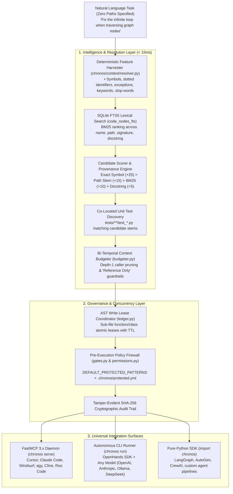

# ⏳ Chronos

**Bi-Temporal Repository Intelligence, Autonomous Context Resolution & Multi-Agent Governance Engine**  
*Agent-agnostic platform supporting OpenHands SDK, Model Context Protocol (MCP), Cursor, Claude Code, Windsurf, LangGraph, AutoGen, and custom AI agents.*

[](tests/)
[](pyproject.toml)
[](chronos/server/mcp_server.py)
[](LICENSE)

---

## 💡 What is Chronos?

Current AI coding agents suffer from three critical production problems:
1. **Context Blindness & Exploration Loops:** Agents spend dozens of costly tool turns blindly browsing directories and reading files to locate relevant code, blowing through token budgets and triggering multi-minute delays.
2. **Security & Policy Hallucinations:** Agents modify safety-critical modules, bypass access controls, leak environment secrets, and clobber protected configs without deterministic pre-execution guardrails.
3. **Multi-Agent Collision & Merge Conflicts:** When multiple agents work on the same repository in parallel, they overwrite each other's edits, lacking atomic sub-file AST locking.
4. **Agent Amnesia:** Agents start every session with zero memory. Lessons learned from fixing subtle bugs or repository invariants evaporate at task termination, repeating the same exploratory mistakes.

**Chronos solves all four:**
- 🔍 **Zero-Path Context Resolution (< 15ms):** Deterministically discovers, ranks, and injects exact AST symbols, call hierarchies, signatures, and matching test files from natural-language prompts *before Turn 1 inference*.
- 🌐 **Polyglot Tree-Sitter AST Indexing:** Out-of-the-box bi-temporal AST indexing across **TypeScript (`.ts`, `.tsx`)**, **JavaScript (`.js`, `.jsx`)**, **Go (`.go`)**, and **Python (`.py`)** with automatic caller extraction, struct/interface embedding, docstrings, and intelligent noise pruning (`node_modules`, `vendor`, `.venv`).
- 🔗 **Cross-File Import Linker & Symbol Disambiguation:** Resolves cross-file dependencies, monorepo tsconfig aliases (`@/*`, `~/*`), Python package hierarchies, and Go module/intra-package scopes into deterministic qualified node IDs (`path::symbol::kind`), with explicit `IMPORTS` edges and `external:` namespaces for third-party libraries.
- 🧠 **Epistemic Living Memory (`agentmem` Integration):** Persistent, cross-session memory with SQLite FTS5 lexical ranking, recency decay, and verification weighting. Features an automated post-task distillation hook to capture bug root causes, failed hypotheses, and procedural invariants, plus pre-turn-1 advisory injection and repository namespace isolation.
- 🛡 **Fail-Closed Security Firewall:** Intercepts agent actions pre-execution at the tool boundary. Blocks unauthorized edits, path escapes, and security breaches before disk modification can occur.
- 🔒 **Sub-File AST Concurrency Leasing:** Bi-temporal write leases at the class/function level prevent parallel agents from clobbering each other's work.
- 🔀 **Universal Agent Fabric:** Connects seamlessly to **any** agent via the Model Context Protocol (MCP), pure Python SDK, or the autonomous CLI runner.

---

## 🏗 Architecture



---

## 📊 Empirical Benchmark Results (Paired Trials)

Chronos was rigorously evaluated in paired 24-task benchmarks against vanilla OpenHands agents:

| Metric | Vanilla Baseline | Chronos Governed | Impact / Improvement |
| :--- | :--- | :--- | :--- |
| **`cooling_task_06` (Security)** | `SECURITY_BREACH` (Disk clobbered) | **`BLOCKED_PRE_EXECUTION`** | **100% Policy Veto** (0 disk writes) |
| **`cng_task_04` (Latency)** | `904.6s` | **`147.0s`** | **-84.0% duration drop** (-757s) |
| **`cng_task_04` (Tokens)** | `883,455` tokens (63 tool turns) | **`131,981`** tokens (13 turns) | **-85.1% token reduction** |
| **`cng_task_05` (Latency)** | `78.4s` | **`28.8s`** | **-63.3% faster than vanilla baseline** |
| **`cng_task_05` (Tokens)** | `72,792` tokens | **`19,741`** tokens | **-72.9% token reduction** |
| **Harness Reliability** | 35+ min unconstrained hang | **180s bounded watchdog** | **Deterministic termination cap** |

---

## 🚀 Quick Start

### 1. Installation

```bash
# Clone repository
git clone https://github.com/your-org/chronos.git
cd chronos

# Create Python 3.12+ virtual environment
python3 -m venv .venv
source .venv/bin/activate

# Install with dependencies
pip install -e .
```

### 2. Verify Toolchain & Database Health

```bash
chronos doctor
```

```text
Chronos Doctor Report:
---------------------
Repository Root : /data/Projects/chronos
Chronos Dir     : OK (.chronos/)
SQLite WAL DB   : OK (15 tables)
Tree-Sitter     : OK
OpenHands SDK   : OK (v1.58.2)
```

---

## 💻 How to Use Chronos

Chronos is completely **agent-agnostic** and can be used across multiple surfaces:

### Option A: Using Chronos in Antigravity (`agy` CLI)

Chronos is registered as a native Model Context Protocol (MCP) server in `agy`.

#### In the `agy` Interactive Chat:
You can directly ask the `agy` agent to use Chronos tools during pair-programming:
- *"Resolve the zero-path context for the prompt: 'Fix boundary condition in registration normalizer'"*
- *"Check the downstream impact of refactoring `SQLiteGraphStore.as_of_impact`"*
- *"List all active callers of `acquire_lock` across the codebase"*
- *"Acquire an AST lock on `src/auth.py::login_handler` before modifying it"*

The agent will seamlessly call `chronos_resolve_zero_path_context`, `as_of_impact`, `as_of_callers`, or `chronos_acquire_lock` through MCP.

#### In the Terminal:
Use the CLI to run autonomous tasks directly:
```bash
chronos run "Fix the infinite loop when traversing graph nodes"
```

---

### Option B: Autonomous Problem Solving via CLI (`chronos run`)

`chronos run` executes autonomous tasks using OpenHands SDK under Chronos governance. It is **provider-agnostic** and works with any model:

```bash
# 1. Using OpenAI (GPT-4o)
export OPENAI_API_KEY="sk-..."
chronos run "Fix race condition in lock ledger" --model=gpt-4o

# 2. Using Anthropic (Claude 3.7 Sonnet)
export ANTHROPIC_API_KEY="sk-ant-..."
chronos run "Refactor payment webhook processing" --model=claude-3-7-sonnet

# 3. Using Free Local Models (Ollama / vLLM)
chronos run "Add boundary checks to cylinder verification" \
  --model=ollama/qwen2.5-coder \
  --base-url=http://localhost:11434

# 4. Using Local Antigravity CLI (Zero External API Keys)
chronos run "Implement regex-based symbol pattern filtering" --model=gemini-3.8-flash-low
```

**CLI Flags:**
- `--model`: Any model string (`gpt-4o`, `claude-3-7-sonnet`, `ollama/...`, `gemini-...`)
- `--api-key`: Explicit API key (or auto-read from environment)
- `--base-url`: Custom API base URL for Ollama / vLLM / local endpoints
- `--max-iterations`: Hard iteration cap (defaults to `20`)
- `--timeout`: Hard task timeout watchdog in seconds (defaults to `300`)
- `--repo`: Target repository root path (defaults to `.`)

---

### Option C: IDE & External Agent Integration via MCP (`chronos serve`)

Expose Chronos tools to **Cursor, Claude Code, Windsurf, Cline, Roo Code, or LibreChat**:

#### 1. Start the FastMCP Daemon
```bash
chronos serve
```

#### 2. Configure Your IDE / Agent Settings
Add to your `mcp_config.json` (or Cursor / Claude Desktop MCP configuration):

```json
{
  "mcpServers": {
    "chronos": {
      "command": "/path/to/chronos/.venv/bin/chronos",
      "args": ["serve"]
    }
  }
}
```

#### Discovered MCP Tools:
| Tool Name | Parameters | Purpose |
| :--- | :--- | :--- |
| `chronos_resolve_zero_path_context` | `prompt`, `token_budget` | Discovers files, symbols, tests & formats Turn 1 context envelope (< 15ms). |
| `chronos_remember` | `content`, `tier`, `namespace`, `tags` | Stores an epistemic memory record (advisory only). |
| `chronos_recall` | `query`, `namespace`, `limit` | Searches and ranks past postmortems, gotchas, and invariants. |
| `chronos_get_procedures` | `namespace` | Retrieves active procedural rules and behavioral invariants. |
| `chronos_memory_stats` | `namespace` | Aggregated statistics on stored epistemic memories. |
| `as_of_impact` | `symbol_name`, `max_depth` | Transitive downstream blast radius analysis before refactoring. |
| `as_of_callers` | `symbol_name` | Direct incoming callers across the repository graph. |
| `as_of_callees` | `symbol_name` | Outgoing functions/classes invoked by a symbol. |
| `as_of_diff` | `t1`, `t2` | Bi-temporal structural AST diff between two timestamps. |
| `chronos_acquire_lock` | `node_id`, `agent_id`, `ttl` | Reserves atomic sub-file AST lease to prevent agent collisions. |
| `chronos_release_lock` | `node_id`, `agent_id` | Releases held sub-file lock. |
| `chronos_list_locks` | *(none)* | Lists all active non-expired AST leases. |

---

### Option D: Epistemic Living Memory Management (`chronos memory`)

Chronos provides CLI commands for managing persistent repository memory:

```bash
# 1. Remember a learned gotcha or invariant
chronos memory remember "Cycle prevention in SQLiteGraphStore requires tracking visited paths in recursive CTE" --tier learned

# 2. Add an explicit behavioral procedure / coding invariant
chronos memory remember "Always run pytest before committing code changes" --tier procedural

# 3. Recall past lessons for a task
chronos memory recall "cycle prevention graph traversal"

# 4. List stored memories
chronos memory list --tier learned

# 5. Inspect memory statistics
chronos memory stats
```

---

### Option D: Python SDK Integration (LangGraph, AutoGen, CrewAI)

Integrate Chronos into custom agent workflows:

```python
import chronos

# 1. Connect to repository graph & database
con = chronos.get_connection(".chronos/chronos.db")
graph_store = chronos.SQLiteGraphStore(con)

# 2. Zero-Path Context Resolution (< 15ms)
resolver = chronos.DeterministicContextResolver(repo_root=".", graph_store=graph_store)
resolution = resolver.resolve("Fix timeout in payment webhook processing")

print("Files to edit   :", resolution.target_files)
print("Symbols to check :", resolution.seed_symbols)
print("Associated tests :", resolution.test_files)
print("Context envelope :\n", resolution.provenance_summary)

# 3. Sub-File AST Write Lease
lock = chronos.acquire_lock(
    con=con,
    node_id="src/payment.py::process_webhook::Function",
    agent_id="worker_01",
    session_id="session_xyz",
    intent="Updating webhook retry logic",
    ttl=300,
)

# 4. Pre-Execution Policy Check
allowed, reason = chronos.check_action_allowed(
    con=con,
    agent_id="worker_01",
    tool_name="file_editor",
    target_path="src/payment.py",
    repo_root=".",
)
if not allowed:
    raise PermissionError(f"Action blocked by Chronos: {reason}")
```

---

## 🛡 Security & Governance Configuration

Chronos includes built-in fail-closed protection for safety-critical patterns (`*policy*`, `*auth*`, `*firewall*`, `*security*`, `*.env*`, `*governor*`).

To customize protected modules in any repository, create `.chronos/protected.yml`:

```yaml
# .chronos/protected.yml
policies:
  - id: core-security
    paths:
      - "src/auth/**"
      - "*policy*"
      - "*credentials*"
      - "*.env*"
    mode: human_approval
    denial_reason: "Security-critical module requires human gate approval."
```

If an unauthorized agent attempts to modify a protected file, Chronos blocks execution at the gateway and logs the denial to `.chronos/chronos-audit.log`.

### Verifying the Audit Trail
Verify that audit logs are cryptographically intact and have not been tampered with:
```bash
chronos audit verify
```
*(Outputs `Audit Chain Verification: PASSED (Records: N)`)*

---

## 🧪 Testing & Verification

Run the complete test suite (unit tests, integration tests, security vector tests, and vertical slices):

```bash
pytest tests/ -v
```

```text
======================== 51 passed, 1 warning in 12.58s ========================
```

---

## 📂 Repository Structure

```
chronos/
├── chronos/
│   ├── audit/             # Append-only SHA-256 cryptographic audit logger
│   ├── cli/               # CLI commands: init, doctor, sync, run, serve, audit
│   ├── context/           # AST indexer, SQLite FTS5 graph store, budgeter, resolver
│   ├── coordination/      # Sub-file AST node locking ledger & conflict detection
│   ├── core/              # SQLite WAL schema, database connection, config models
│   ├── security/          # Fail-closed gates, human approvals, permission manifests
│   ├── server/            # FastMCP 3.x server for IDE / external agent integration
│   └── telemetry/         # Token accounting, latency metrics, session telemetry
├── runtime/               # OpenHands adapter, tool wrappers, hooks, context condenser
├── benchmarks/            # 24-task paired benchmark harness, runs, diffs, and reports
├── tests/                 # 51 unit & integration tests covering security, context, MCP
└── pyproject.toml         # Packaging configuration & CLI entry points
```

---

## 📄 License

MIT License. See [LICENSE](LICENSE) for details.
