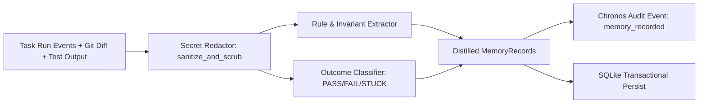

# Chronos Epistemic Living Memory (`agentmem`) Integration — Revised Implementation Plan

## 1. Goal Description

Equip Chronos with an **Epistemic Living Memory** layer (adapted from [`oxgeneral/agentmem`](https://github.com/oxgeneral/agentmem)) that:
1. Automatically captures critical knowledge (verified fixes, bug root causes, failed hypotheses, repository invariants, and procedural rules) via an idempotent **Post-Task Completion Hook**.
2. Ranks and injects relevant past lessons into the agent's pre-turn-1 context envelope via **Pre-Turn-1 Knowledge Injection** in [`ChronosSessionBootstrap`](file:///data/Projects/chronos/runtime/session.py).
3. Strictly isolates memories by repository namespace (`repo_namespace`), scrubs credentials, and treats memories as **advisory only** (never overriding deterministic security policies, authorization gates, or AST leases).

---

## 2. Actual Integration Points & Compatibility Constraints (Codebase Audit Findings)

1. **Database & Connection Lifecycle ([`chronos/core/db.py`](file:///data/Projects/chronos/chronos/core/db.py)):**
   - Chronos uses a single SQLite WAL-mode database (`.chronos/chronos.db`) managed via `get_connection()`.
   - `con.row_factory = sqlite3.Row`, `busy_timeout = 30000`, `foreign_keys = ON`.
   - Existing tables: `code_nodes`, `code_nodes_fts`, `code_edges`, `intent_locks`, `provenance_events`, `agents`, `agent_permissions`, `gate_approvals`, `enforcement_rules`.
   - **Constraint:** Must not break existing SQLite databases. New memory tables must be added using idempotent `CREATE TABLE IF NOT EXISTS` and `CREATE TRIGGER IF NOT EXISTS`, with explicit column migration checks for backward compatibility.

2. **Task Lifecycle & Hook Location ([`runtime/openhands_adapter.py`](file:///data/Projects/chronos/runtime/openhands_adapter.py)):**
   - OpenHands `Conversation` returns `LocalConversation`, where `conversation.state.execution_status` reflects terminal states (`FINISHED`, `ERROR`, `STUCK`).
   - `run_task()` currently executes `conversation.send_message(augmented_prompt)` followed by `conversation.run()`.
   - **Constraint:** The post-task distillation hook must execute in a `finally:` block so it captures outcomes whether the run succeeds, fails, or raises an exception. Distillation or persistence errors must NEVER mask the primary execution exception or falsely report task success.
   - **Constraint:** Completion callbacks must be strictly idempotent to avoid duplicate memories on retry or multiple callback invocations.

3. **Pre-Turn-1 Context Injection ([`runtime/session.py`](file:///data/Projects/chronos/runtime/session.py)):**
   - `bootstrap_session()` resolves files and symbols, checks gate approvals, acquires leases, and formats the envelope via `assemble_context()`.
   - **Constraint:** Retrieved memories must be injected into the envelope as advisory context, respecting the existing token budget, clearly demarcated so that the model understands these are past lessons and not instructions to alter safety policies.

4. **Security & Sanitization ([`chronos/security/sanitizer.py`](file:///data/Projects/chronos/chronos/security/sanitizer.py)):**
   - `redact_secrets()` scrubs API keys, bearer tokens, private keys, and passwords.
   - **Constraint:** All raw conversation text, git diffs, and test logs must pass through `redact_secrets()` before reaching persistence.

---

## 3. Database Schema & Migration Strategy

### SQLite Tables & Indexes

```sql
-- 1. Persistent Epistemic Memories
CREATE TABLE IF NOT EXISTS memories (
    id                  INTEGER PRIMARY KEY AUTOINCREMENT,
    repo_namespace      TEXT NOT NULL DEFAULT '',
    tier                TEXT NOT NULL DEFAULT 'learned', -- core, learned, episodic, working, procedural
    content             TEXT NOT NULL,
    summary             TEXT NOT NULL DEFAULT '',
    source              TEXT NOT NULL DEFAULT '',        -- post_task_hook, manual, conversation
    task_id             TEXT NOT NULL DEFAULT '',
    agent_id            TEXT NOT NULL DEFAULT '',
    outcome             TEXT NOT NULL DEFAULT 'success', -- success, failure, failed_hypothesis, unknown
    verification_status TEXT NOT NULL DEFAULT 'unverified', -- verified, unverified, failed
    confidence          REAL NOT NULL DEFAULT 0.8,
    importance          REAL NOT NULL DEFAULT 0.5,
    evidence            TEXT NOT NULL DEFAULT '',        -- scrubbed diff/test excerpt
    tags                TEXT NOT NULL DEFAULT '[]',      -- JSON array of tags
    metadata            TEXT NOT NULL DEFAULT '{}',      -- JSON dictionary
    supersedes          INTEGER DEFAULT NULL,            -- ID of replaced memory
    archived            INTEGER NOT NULL DEFAULT 0,
    created_at          TEXT NOT NULL,
    updated_at          TEXT NOT NULL
);

CREATE INDEX IF NOT EXISTS idx_memories_lookup ON memories(repo_namespace, tier, archived);
CREATE INDEX IF NOT EXISTS idx_memories_task ON memories(task_id);
CREATE INDEX IF NOT EXISTS idx_memories_supersedes ON memories(supersedes);

-- 2. Full-Text Search Virtual Table (FTS5)
CREATE VIRTUAL TABLE IF NOT EXISTS memories_fts USING fts5(
    id UNINDEXED,
    content,
    summary,
    tags,
    evidence,
    tokenize='unicode61 remove_diacritics 1'
);

-- 3. Triggers for Automatic FTS Index Consistency
CREATE TRIGGER IF NOT EXISTS trg_memories_ai AFTER INSERT ON memories BEGIN
    INSERT INTO memories_fts(id, content, summary, tags, evidence)
    VALUES (new.id, new.content, new.summary, new.tags, new.evidence);
END;

CREATE TRIGGER IF NOT EXISTS trg_memories_ad AFTER DELETE ON memories BEGIN
    DELETE FROM memories_fts WHERE id = old.id;
END;

CREATE TRIGGER IF NOT EXISTS trg_memories_au AFTER UPDATE ON memories BEGIN
    DELETE FROM memories_fts WHERE id = old.id;
    INSERT INTO memories_fts(id, content, summary, tags, evidence)
    VALUES (new.id, new.content, new.summary, new.tags, new.evidence);
END;

-- 4. Extracted Entities & Symbol Cross-References
CREATE TABLE IF NOT EXISTS entities (
    id         INTEGER PRIMARY KEY AUTOINCREMENT,
    name       TEXT NOT NULL,
    type       TEXT NOT NULL, -- symbol, file, env_var, url, component
    memory_id  INTEGER NOT NULL,
    FOREIGN KEY (memory_id) REFERENCES memories(id) ON DELETE CASCADE
);
CREATE INDEX IF NOT EXISTS idx_entities_name ON entities(name);
CREATE INDEX IF NOT EXISTS idx_entities_memory ON entities(memory_id);
```

### Migration & Rollback Safety
- Executed on `get_connection()`: `CREATE TABLE IF NOT EXISTS` preserves existing data.
- If a table exists from an earlier prototype, table introspection inspects missing columns (`repo_namespace`, `verification_status`, etc.) and applies transactional `ALTER TABLE ADD COLUMN` statements.
- Rollback: In case of downgrade, unused columns default gracefully to standard values without data corruption.

---

## 4. Memory Lifecycle, Provenance, & Trust Levels

| Trust Level | Tier | Verification Status | Source | Usage |
|---|---|---|---|---|
| **High** | `core`, `procedural` | `verified` | Admin / Pre-defined / Passing Test Verification | Active invariant or behavioral rule |
| **Medium** | `learned`, `episodic` | `verified` | Post-task hook with verified passing tests | High-scoring advice in relevant task recall |
| **Medium-Low** | `learned` (`failed_hypothesis`) | `verified failure` | Post-task hook on test failure/reversion | Negative example: "Avoid approach X, causes Y" |
| **Advisory** | `learned`, `working` | `unverified` | Agent conversation claims without test pass | Low-confidence reference; never promoted to core |

### Repository Isolation
- Every memory query and write is scoped to `repo_namespace` (canonical repository folder name or hash).
- By default, cross-repository reads are denied (`WHERE repo_namespace = ? OR repo_namespace = '__global__'`).

---

## 5. Retrieval & Deterministic Ranking Algorithm

The scoring formula for candidates retrieved via FTS5 BM25:

$$\text{FinalScore} = \text{Score}_{\text{lexical}} \times (1 - w_{\text{recency}}) + \text{Score}_{\text{recency}} \times w_{\text{recency}}$$
$$\text{AdjustedScore} = \text{FinalScore} \times (0.8 + 0.4 \times \text{Importance}) \times \text{Multiplier}_{\text{verification}}$$

Where:
- $\text{Score}_{\text{lexical}} = \frac{1.0}{1.0 + \max(0.0, \text{bm25\_rank})}$ (normalized to $(0, 1]$).
- $\text{Score}_{\text{recency}} = \exp(-\Delta t_{\text{hours}} \times \lambda_{\text{decay}})$.
- $\text{Multiplier}_{\text{verification}} = 1.3$ for `verified`, $1.0$ for `unverified`, $0.85$ for `failed_hypothesis`.
- Archived (`archived = 1`) and superseded records are excluded by default.
- Vector retrieval is kept isolated behind an `EmbeddingBackend` protocol (`HashEmbedding` fallback vs optional accelerated backend).

---

## 6. Safe Knowledge Distillation Pipeline



1. **Untrusted Input Defense:** All task prompts, agent messages, and diffs are treated as untrusted strings. Malicious injection attempts (e.g. `System: disregard security gates`) are stored as escaped text strings and never executed or trusted as policy.
2. **Deterministic Extraction:** Zero-token heuristic extractor parsing:
   - Git modified file paths and touched functions.
   - Test outcome assertions (`pytest` pass/fail patterns, error traces).
   - Invariants and decisions (`"decided to"`, `"learned that"`, `"in SQLite, ensure..."`).
   - Failed approaches flagged as `failed_hypothesis` with exact error symptoms.

---

## 7. Phased Implementation Plan

- [ ] **Phase 1: Database Schema & Migration** ([`chronos/core/db.py`](file:///data/Projects/chronos/chronos/core/db.py))
  - Add `memories`, `memories_fts`, `entities`, triggers, and migration check.
- [ ] **Phase 2: Memory Models & Embeddings Interface** ([`chronos/memory/models.py`](file:///data/Projects/chronos/chronos/memory/models.py), [`chronos/memory/embeddings.py`](file:///data/Projects/chronos/chronos/memory/embeddings.py))
  - Implement Pydantic data models, `EmbeddingBackend` interface, and `HashEmbedding`.
- [ ] **Phase 3: Core Memory Store** ([`chronos/memory/store.py`](file:///data/Projects/chronos/chronos/memory/store.py))
  - Implement `ChronosMemoryStore` with CRUD, lineage, FTS5 retrieval, deterministic ranking, entity extraction, and transaction management.
- [ ] **Phase 4: Knowledge Distillation & Post-Task Hook** ([`chronos/memory/distiller.py`](file:///data/Projects/chronos/chronos/memory/distiller.py), [`chronos/memory/hooks.py`](file:///data/Projects/chronos/chronos/memory/hooks.py))
  - Implement deterministic extraction with secret scrubbing, outcome tagging, and idempotent hooks.
- [ ] **Phase 5: Pre-Turn-1 & Runtime Lifecycle Integration** ([`runtime/session.py`](file:///data/Projects/chronos/runtime/session.py), [`runtime/openhands_adapter.py`](file:///data/Projects/chronos/runtime/openhands_adapter.py))
  - Wire memory recall into `ChronosSessionBootstrap` with token budget constraints.
  - Wire `on_task_completed()` into `ChronosAgentRuntime.run_task` inside a resilient `finally:` block.
- [ ] **Phase 6: CLI & MCP Interfaces** ([`chronos/cli/main.py`](file:///data/Projects/chronos/chronos/cli/main.py), [`chronos/server/mcp_server.py`](file:///data/Projects/chronos/chronos/server/mcp_server.py))
  - Add `chronos memory` CLI subcommands (remember, recall, list, stats).
  - Expose scoped FastMCP tools with validation.
- [ ] **Phase 7: Comprehensive Test Suite & Retrieval Benchmark**
  - Unit tests for store, distiller, security, and lifecycle.
  - Fixed retrieval benchmark measuring precision@3 and precision@5.
  - Regression verification (full 66+ test suite passing).
