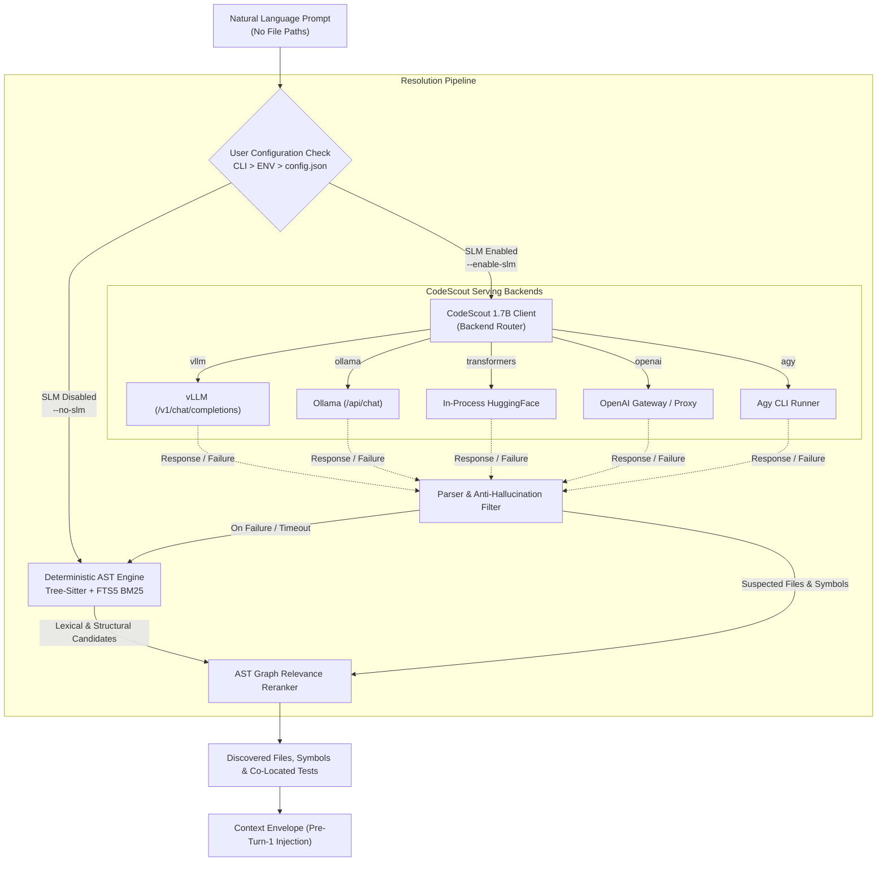

# Production-Grade OpenHands CodeScout-1.7B SLM Integration Plan

## 1. Executive Summary & Architectural Goals

The goal of this initiative is to elevate Chronos's Zero-Path Context Resolution with a **production-grade integration of `OpenHands/CodeScout-1.7B`** as our primary Small Language Model (SLM), while maintaining **complete user autonomy** over whether SLM inference is utilized.

### Core Philosophy
1. **User Choice First (Opt-In / Opt-Out):** The user explicitly controls whether SLM reasoning is active via CLI flags, project configuration, or environment variables. 
2. **Advisory Acceleration, Never a Hard Dependency:** When SLM is disabled or unavailable, Chronos operates 100% deterministically using Tree-Sitter polyglot AST call graphs, caller/callee traversal, and SQLite FTS5 BM25 lexical ranking.
3. **Multi-Backend Production Serving:** Support the diverse deployment topologies used in production:
   - **vLLM (Recommended for servers / clusters):** High-throughput OpenAI-compatible endpoint.
   - **Ollama (Recommended for developer laptops / workstations):** Local zero-config model execution.
   - **In-Process Transformers (Zero external daemon dependency):** Direct PyTorch/HuggingFace pipeline with optional 4-bit quantization and lazy initialization.
   - **Generic OpenAI-Compatible Gateway:** LiteLLM proxy, TGI, FastChat, or remote clusters.
   - **Agy / Cloud Fallback:** Existing lightweight CLI runner.
4. **Resilient Zero-Degradation Fallback:** If an SLM call fails (timeout, connection refused, out-of-memory, invalid JSON), Chronos emits a clean warning and falls back immediately to AST + BM25 with zero latency overhead and zero crashes.

---

## 2. System Architecture



---

## 3. Configuration & User Choice Architecture

We introduce a first-class `SLMConfig` model in `chronos/core/config.py` with full configuration hierarchy:

### A. Configuration Schema (`chronos/core/config.py`)

```python
from enum import Enum
from typing import Optional
from pydantic import BaseModel, Field

class SLMBackend(str, Enum):
    VLLM = "vllm"
    OLLAMA = "ollama"
    TRANSFORMERS = "transformers"
    OPENAI = "openai"
    AGY = "agy"
    NONE = "none"

class SLMConfig(BaseModel):
    enabled: bool = Field(
        default=False, 
        description="Whether SLM zero-path resolution is active. When False, uses deterministic AST + BM25."
    )
    model: str = Field(
        default="OpenHands/CodeScout-1.7B",
        description="Hugging Face repo ID, Ollama model tag, or custom model identifier."
    )
    backend: SLMBackend = Field(
        default=SLMBackend.VLLM,
        description="Inference backend engine (vllm, ollama, transformers, openai, agy)."
    )
    endpoint: Optional[str] = Field(
        default="http://localhost:8000/v1",
        description="Base URL for vLLM, Ollama, or OpenAI-compatible server."
    )
    api_key: Optional[str] = Field(
        default="EMPTY",
        description="API key for authentication if required by proxy."
    )
    timeout_seconds: int = Field(
        default=25,
        description="Maximum seconds before falling back to deterministic AST resolution."
    )
    temperature: float = Field(default=0.1)
    max_candidate_files: int = Field(
        default=150,
        description="Maximum candidate repository files provided in context to the SLM."
    )
    quantization: Optional[str] = Field(
        default="4bit",
        description="Quantization for in-process transformers backend ('4bit', '8bit', 'bfloat16', None)."
    )
```

### B. Configuration Precedence

1. **CLI Flags (Highest priority):**
   - `--enable-slm` / `--no-slm`
   - `--slm-backend [vllm|ollama|transformers|openai|agy]`
   - `--slm-model <id>`
   - `--slm-endpoint <url>`
2. **Environment Variables:**
   - `CHRONOS_ENABLE_SLM` (`true` / `false` / `1` / `0`)
   - `CHRONOS_SLM_MODEL` (e.g. `OpenHands/CodeScout-1.7B`)
   - `CHRONOS_SLM_BACKEND` (e.g. `vllm`, `ollama`)
   - `CHRONOS_SLM_ENDPOINT` (e.g. `http://localhost:8000/v1`)
   - `CHRONOS_SLM_API_KEY`
3. **Repository Configuration (`.chronos/config.json`):**
   ```json
   {
     "slm": {
       "enabled": true,
       "model": "OpenHands/CodeScout-1.7B",
       "backend": "vllm",
       "endpoint": "http://localhost:8000/v1"
     }
   }
   ```
4. **Default Setting:**
   - Default is **`enabled: False`** (opt-in) for pure deterministic environments, or **auto-detected** if a local vLLM/Ollama service is actively running on standard ports.

---

## 4. Backend Implementation Specifications

### Backend 1: vLLM (`VLLMBackend`) — Production Standard
- Target: Running via `vllm serve OpenHands/CodeScout-1.7B --port 8000`.
- Protocol: Standard OpenAI-compatible HTTP POST to `{endpoint}/chat/completions`.
- Features: High concurrency, batching, PagedAttention, KV-caching.
- Request payload uses `response_format={"type": "json_object"}` when supported.

### Backend 2: Ollama (`OllamaBackend`) — Developer Workstation
- Target: Running via `ollama run hf.co/OpenHands/CodeScout-1.7B` or `ollama serve`.
- Protocol: Direct HTTP to `http://localhost:11434/api/chat` or `http://localhost:11434/v1/chat/completions`.
- Features: Lightweight single-binary installation on Linux/macOS/Windows with zero Python dependencies.

### Backend 3: In-Process Hugging Face (`TransformersBackend`) — Embedded / Zero-Daemon
- Target: Python environments with `torch` and `transformers` installed.
- Loading: Lazy, on-demand loading on first call (avoids startup penalty when SLM is unused).
- Features:
  - Supports `bitsandbytes` 4-bit NF4 quantization (`device_map="auto"`) for low VRAM (~2.5GB VRAM footprint).
  - CPU offload fallback if CUDA is unavailable.
  - Cached under `~/.cache/huggingface/hub/`.

### Backend 4: Generic OpenAI (`OpenAIBackend`)
- Target: Custom proxies (LiteLLM, FastChat, OpenRouter, self-hosted API gateways).

### Backend 5: Agy / Cloud Fallback (`AgyBackend`)
- Target: Environments running the Antigravity CLI runner.

---

## 5. CodeScout Prompt Engineering & Anti-Hallucination

CodeScout-1.7B was trained via GSPO reinforcement learning on SWE-bench specifically for localization. The prompt structure is optimized for CodeScout's training distribution:

```text
[SYSTEM]
You are CodeScout, an expert code search and localization agent.
Given a natural-language issue or task description and a list of repository files, identify the exact target files and functions that must be modified to solve the problem.

Format your output strictly as a JSON object:
{
  "suspected_files": ["relative/path/to/file.py"],
  "suspected_symbols": ["symbol_or_function_name"],
  "domain_concepts": ["concept1", "concept2"],
  "intent": "bug_fix" | "feature" | "refactor" | "security",
  "rationale": "Concise explanation of why these files need changes"
}

[USER]
REPOSITORY SOURCE FILES:
<filtered_candidate_files>

TASK DESCRIPTION:
<natural_language_prompt>
```

### Anti-Hallucination Gate
Every path returned by CodeScout is validated against the actual repository tree:
1. Exact match on disk -> accepted.
2. Basename suffix match (e.g. `ledger.py` matching `chronos/coordination/ledger.py`) -> normalized to actual relative path.
3. Completely nonexistent file -> filtered out before AST graph traversal.

---

## 6. CLI & Operational Ergonomics

We enhance the CLI commands across Chronos to provide intuitive SLM management:

### 1. `chronos resolve`
```bash
# Explicitly use CodeScout with vLLM
chronos resolve "Fix deadlock in coordination ledger" --enable-slm --slm-backend vllm

# Explicitly disable SLM (pure AST + BM25)
chronos resolve "Fix deadlock in coordination ledger" --no-slm

# Use Ollama backend
chronos resolve "Sanitize secret keys in audit log" --enable-slm --slm-backend ollama --slm-endpoint http://localhost:11434/v1
```

### 2. `chronos run`
```bash
# Run OpenHands agent with CodeScout zero-path bootstrap
chronos run "Fix race condition in lock lease renewal" --enable-slm

# Run with pure deterministic AST resolution
chronos run "Fix race condition in lock lease renewal" --no-slm
```

### 3. `chronos doctor`
Adds an SLM Diagnostics section:
```text
SLM Zero-Path Resolver:
  Configuration : Enabled (Opt-In)
  Backend       : vLLM (http://localhost:8000/v1)
  Model         : OpenHands/CodeScout-1.7B
  Service Health: ONLINE (HTTP 200, Ping Latency: 14ms)
  Inference Test: PASSED (Resolved sample query in 312ms)
```

### 4. `chronos config`
```bash
# Toggle SLM on or off in .chronos/config.json
chronos config set slm.enabled true
chronos config set slm.backend vllm
chronos config set slm.model OpenHands/CodeScout-1.7B
```

---

## 7. Phased Implementation Steps

| Phase | Component | Detailed Tasks | Acceptance Criteria |
| :--- | :--- | :--- | :--- |
| **Phase 1** | **Configuration & Schema** | • Implement `SLMConfig` and `SLMBackend` in `chronos/core/config.py`<br>• Wire environment variable overrides and `.chronos/config.json` loading<br>• Add CLI flags (`--enable-slm`, `--no-slm`, `--slm-backend`, `--slm-model`, `--slm-endpoint`) to `chronos/cli/main.py` | Configuration precedence works cleanly: CLI > ENV > JSON > Default. |
| **Phase 2** | **CodeScout Client & Backend Routers** | • Refactor `chronos/context/slm_resolver.py` to support `VLLMBackend`, `OllamaBackend`, `TransformersBackend`, `OpenAIBackend`, and `AgyBackend`<br>• Implement lazy loading for `transformers`<br>• Standardize JSON extraction and anti-hallucination validation | All backends handle CodeScout's output and validate paths against repository root. |
| **Phase 3** | **Resolver & Bootstrap Wiring** | • Update `DeterministicContextResolver` to accept `SLMConfig`<br>• Update `ChronosSessionBootstrap` and `ChronosAgentRuntime` to propagate user SLM choice<br>• Update benchmark harness `runner.py` to support `--enable-slm` / `--no-slm` | Resolver executes SLM only when requested; falls back to AST + BM25 on failure or when disabled. |
| **Phase 4** | **Doctor & Diagnostics** | • Add SLM connectivity ping and diagnostic reporting to `chronos doctor`<br>• Implement `chronos config` helper commands | `chronos doctor` reports accurate health for local/remote SLM backends. |
| **Phase 5** | **Testing & Verification** | • Unit tests for all backends (mocked HTTP/Ollama/Transformers)<br>• Unit tests for opt-in/opt-out configuration precedence<br>• Unit tests for anti-hallucination and fallback safety<br>• End-to-end CLI integration test | All 89+ tests pass; zero regressions. |

---

## 8. Verification & Acceptance Criteria

1. **Opt-Out Test:** Calling `chronos resolve "..." --no-slm` executes 100% locally via Tree-Sitter AST & SQLite BM25 in <50ms without initiating any network connection or model loading.
2. **Opt-In Test:** Calling `chronos resolve "..." --enable-slm` routes prompt through the configured CodeScout backend and returns targeted files with SLM provenance.
3. **Resilience Test:** When `--enable-slm` is specified with an unreachable endpoint (e.g. `http://localhost:9999/v1`), the resolver logs a diagnostic warning and successfully returns the AST + BM25 resolution without an unhandled exception.
4. **Test Suite Integrity:** The full test suite passes with 100% green status.
