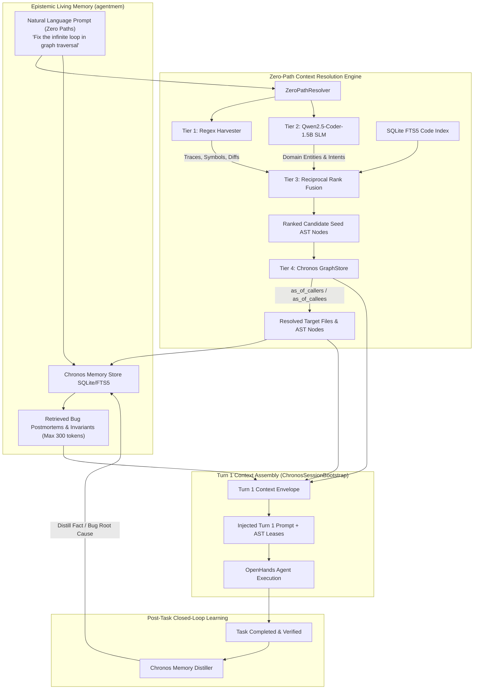

# Chronos Epistemic Living Memory & Zero-Path Resolution Architecture — Implementation Plan

## Goal Description

Enable Chronos to automatically resolve context from conversational natural language prompts without requiring the user to specify file paths, and build an **Epistemic Living Memory Layer** (inspired by [`oxgeneral/agentmem`](https://github.com/oxgeneral/agentmem)) that automatically extracts, indexes, and injects bug postmortems, repository invariants, and learned facts across agent sessions.

### Problem Statement
1. **The "Zero-Path" Problem**: Real users and upstream orchestrators rarely provide exact file paths (e.g. `chronos/context/graph.py:131`). Instead, they supply conversational prompts (e.g., *"Fix the infinite loop when traversing graph nodes"* or *"Registration normalizer is dropping leading zeros"*). Without file anchors, AST graph traversal and sub-file lease locking cannot seed their entrypoints.
2. **Stateless Agent Amnesia**: When an agent discovers a subtle bug, non-obvious framework quirk, or repository invariant, that knowledge vanishes when the session terminates. Future agents repeat the same exploratory mistakes.

### Core Solution
1. **Zero-Path Context Resolution Engine**:
   - **Tier 1 (Deterministic Regex Harvester)**: Microsecond extraction of stack traces, exception names, CamelCase/snake_case symbols, and git diff hunks.
   - **Tier 2 (Local Qwen2.5-Coder-1.5B SLM Sidecar)**: Fast local entity & intent extraction mapping natural language problem descriptions to domain concepts without cloud latency or token cost.
   - **Tier 3 (Reciprocal Rank Fusion & FTS5)**: Weighted fusion of regex tokens, SLM domain entities, and SQLite FTS5 code search to identify high-confidence seed AST nodes.
   - **Tier 4 (Chronos Bi-Temporal Graph Expansion)**: Walks 1–2 hops of callers, callees, and co-edited tests from seed nodes.
2. **Epistemic Living Memory Store (`agentmem` architecture)**:
   - SQLite-backed memory store (`.chronos/chronos.db` or `.chronos/memory.db`) with FTS5 virtual tables and AST `node_id` foreign keys.
   - Post-session automatic distillation: extracts bug root causes and learned invariants from task prompts, git diffs, and verification outputs.
   - Pre-Turn-1 injection: ranks and injects top-scoring relevant past postmortems directly into the agent's context envelope.



---

## User Review Required

> [!IMPORTANT]
> **Local SLM Runtime Environment**:
> The plan integrates **Qwen2.5-Coder-1.5B-Instruct**. In production environments, this can run via:
> 1. Local **Ollama** (`http://localhost:11434`) or **llama.cpp / vLLM** server.
> 2. Local Python **Transformers / ONNX** pipeline.
> 
> The implementation will feature an **automatic graceful degradation fallback**: if the local Qwen daemon is offline or uninstalled, the resolver immediately falls back to Tier 1 (Regex Harvester) + SQLite FTS5 keyword matching with **zero downtime and zero crashes**.

> [!NOTE]
> **Zero Code Modifications During Planning**:
> As instructed, no code, tests, or configurations will be modified until explicit user approval is provided. The ongoing 24-task paired benchmark running in the background will continue uninterrupted.

---

## Open Questions

1. **Local SLM Serving Preference**:
   - Would you prefer Chronos to connect to a running **Ollama / vLLM / OpenAI-compatible endpoint** (e.g. `http://localhost:11434/v1` or `http://localhost:8000/v1`), or package a self-contained local Python runner (via `llama-cpp-python` / `transformers`)?
   - *(Recommendation)*: Support both via an adapter: check for local endpoint first, fallback to regex + FTS5.

2. **Memory Persistence Scope**:
   - Should memory records be stored directly inside the existing `.chronos/chronos.db` database (keeping everything in a single portable file), or in a dedicated `.chronos/memory.db` file?
   - *(Recommendation)*: Keep inside `.chronos/chronos.db` under dedicated `agent_memories` and `agent_memories_fts` tables to maintain single-file zero-configuration simplicity.

3. **Failed vs. Successful Task Extraction**:
   - Should Chronos distill memories **only when verification commands pass** (guaranteeing that only verified fixes are remembered), or also capture **failed hypotheses** (e.g., *"Attempting approach X caused test failure Y; avoid X"*)?
   - *(Recommendation)*: Distill both, tagged with `outcome: "verified_fix"` vs `outcome: "failed_hypothesis"`.

---

## Proposed Changes

Grouped by component layer:

```
chronos/
├── memory/
│   ├── [NEW] __init__.py
│   ├── [NEW] models.py
│   ├── [NEW] store.py
│   └── [NEW] extractor.py
├── resolver/
│   ├── [NEW] __init__.py
│   ├── [NEW] regex_harvester.py
│   ├── [NEW] local_slm.py
│   ├── [NEW] fusion.py
│   └── [NEW] engine.py
runtime/
│   ├── [MODIFY] session.py
│   └── [MODIFY] openhands_adapter.py
tests/
│   ├── [NEW] test_memory_store.py
│   ├── [NEW] test_zero_path_resolver.py
│   └── [NEW] test_memory_distillation.py
```

---

### Component 1: `chronos.memory` (Epistemic Living Memory)

#### [NEW] `chronos/memory/models.py`
Data schemas for memory records, bug postmortems, and tiered classifications:
* `MemoryTier` enum: `LEARNED` (bug fixes, gotchas), `PROCEDURAL` (conventions, rules), `CORE` (repo invariants), `HYPOTHESIS_FAILED` (approaches that broke tests).
* `MemoryRecord`: Pydantic model with `id`, `tier`, `target_file`, `symbol_id`, `summary`, `root_cause`, `resolution`, `tags`, `confidence`, `valid_at`, `invalid_at`.

#### [NEW] `chronos/memory/store.py`
SQLite store managing `agent_memories` table and FTS5 virtual index:
```python
class MemoryStore:
    def __init__(self, con: sqlite3.Connection): ...
    def save_memory(self, record: MemoryRecord) -> str: ...
    def search_by_symbols(self, symbols: List[str], limit: int = 5) -> List[MemoryRecord]: ...
    def search_by_fts(self, query: str, limit: int = 5) -> List[MemoryRecord]: ...
    def search_hybrid(self, query: str, symbols: List[str], target_files: List[str], limit: int = 5) -> List[MemoryRecord]: ...
    def invalidate_symbol_memories(self, symbol_id: str) -> None: ...
```

#### [NEW] `chronos/memory/extractor.py`
Distillation engine that triggers after task execution:
* Inputs: `task_prompt`, `git_patch`, `test_stdout`, `test_stderr`, `outcome` (PASS/FAIL).
* Uses prompt template to extract:
  - Concise bug postmortem summary (< 40 words).
  - Target symbol and file association.
  - Recommended invariant or gotcha.
* Saves record to `MemoryStore`.

---

### Component 2: `chronos.resolver` (Zero-Path Context Resolution Engine)

#### [NEW] `chronos/resolver/regex_harvester.py`
Deterministic pattern extraction for zero-latency detection:
* Stack trace parser: Python, Node, Go, Rust trace patterns extracting file paths and line numbers.
* Symbol extractor: CamelCase class identifiers, `snake_case` functions, dotted module paths.
* Error extractor: `*Error`, `*Exception`, `panic:`, `FATAL:`.
* Git state harvester: uncommitted modified files via `git status --porcelain`.

#### [NEW] `chronos/resolver/local_slm.py`
Client for Qwen2.5-Coder-1.5B:
* Connects via OpenAI-compatible local API (e.g. Ollama `/v1` or local endpoint).
* System prompt constrained to JSON schema:
  ```json
  {
    "domain_concepts": ["cycle_detection", "recursive_cte", "impact_tree"],
    "intent": "bug_fix",
    "suspected_symbols": ["as_of_impact", "GraphStore"]
  }
  ```
* Resilient error handling: if endpoint times out (> 300ms) or is unreachable, returns empty concept list without failing the turn.

#### [NEW] `chronos/resolver/fusion.py`
Reciprocal Rank Fusion (RRF) implementation:
* Combines candidate symbol rankings from:
  1. Regex Harvester (weight: 1.0)
  2. Code FTS5 index (weight: 0.7)
  3. Qwen SLM Domain Concepts (weight: 0.6)
* Produces top $K$ ordered seed AST nodes.

#### [NEW] `chronos/resolver/engine.py`
`ZeroPathResolver`:
```python
class ZeroPathResolver:
    def __init__(self, repo_root: Path, con: sqlite3.Connection, slm_client: Optional[LocalSLMClient] = None): ...
    def resolve_context(self, prompt: str, explicit_files: Optional[List[str]] = None) -> ResolutionResult:
        # 1. Harvest regex tokens
        # 2. Query SLM concepts (if available)
        # 3. Search FTS5 symbols
        # 4. RRF ranking to select top seed nodes
        # 5. GraphStore expansion (callers, callees, test files)
        # Returns resolved_files, resolved_symbols, and seed_nodes
```

---

### Component 3: `runtime` Integration

#### [MODIFY] `runtime/session.py` (`ChronosSessionBootstrap`)
1. Integrate `ZeroPathResolver`:
   - If `target_files` is empty or prompt has no explicit paths, call `self.resolver.resolve_context(task_prompt)`.
   - Use resolved target files and symbols for AST graph expansion and initial lease acquisition.
2. Integrate `MemoryStore`:
   - Query hybrid memories matching the resolved symbols and prompt.
   - Format top 3 memories into the Turn 1 envelope under:
     ```markdown
     #### 🧠 Chronos Repository Memory & Known Gotchas (from past sessions):
     - [Bug Postmortem]: Cycle prevention in SQLiteGraphStore.as_of_impact requires tracking visited paths in recursive CTE.
     - [Invariant]: create_graph_store falls back from Kuzu to SQLite if kuzu package is missing.
     ```

#### [MODIFY] `runtime/openhands_adapter.py`
* Add `extract_session_memory()` hook in post-execution lifecycle to automatically distill learnings when a task or conversation concludes.

---

## Verification Plan

### Automated Tests

```bash
# 1. Run new memory store and FTS5 hybrid search tests
.venv/bin/pytest tests/test_memory_store.py -v

# 2. Run regex harvester, SLM fallback, and zero-path resolver tests
.venv/bin/pytest tests/test_zero_path_resolver.py -v

# 3. Run memory distillation pipeline tests
.venv/bin/pytest tests/test_memory_distillation.py -v

# 4. Run entire Chronos test suite to ensure zero regressions
.venv/bin/pytest tests/ -q
```

### End-to-End Adversarial & Scenario Verification
1. **Adversarial Zero-Path Test**:
   - Provide prompt with zero paths: *"Fix circular reference recursion edge case where mutually recursive functions cause infinite recursion during traversal."*
   - Verify `ZeroPathResolver` correctly identifies `chronos/context/graph.py` and `SQLiteGraphStore.as_of_impact` as top candidates.
   - Verify AST leases are acquired on `graph.py` symbols.
2. **Cross-Session Memory Injection Test**:
   - Insert synthetic bug postmortem into `agent_memories`.
   - Start session on related topic.
   - Assert Turn 1 envelope contains the exact postmortem without the agent asking for it.
3. **Graceful Fallback Test**:
   - Run resolver with SLM endpoint forcibly down/invalid.
   - Assert Tier 1 (Regex) + FTS5 successfully resolves candidates within < 10ms.
