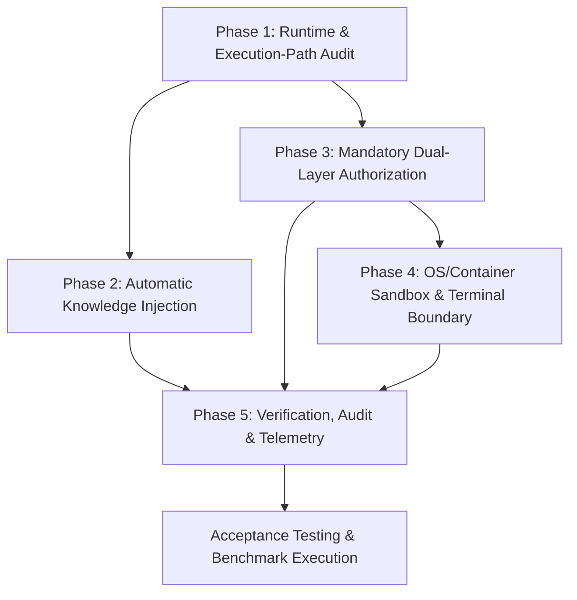

# Chronos: Mandatory Knowledge & Enforcement Architecture
## Phased Implementation Plan

**Target Runtime:** OpenHands SDK v1.58.2  
**Constraint:** Zero production source modifications during planning phase.

---

## 1. Implementation Roadmap & Phase Dependencies



---

## 2. Phase Breakdown

### Phase 1: Runtime & Execution-Path Audit
- **Objective:** Establish baseline telemetry, map all OpenHands SDK tool invocation routes, and verify fail-closed hook execution.
- **Affected Files:**
  - `runtime/openhands_adapter.py`
  - `runtime/hooks.py`
  - `tests/test_runtime_hooks.py`
- **Key Changes:**
  - Audit OpenHands `_ActionBatch.prepare` and `_execute_action_event` execution paths.
  - Implement hook error-handling harness ensuring any unhandled exception or non-zero exit in `evaluate_tool_security` forces `HookDecision.DENY` (overriding OpenHands SDK's default `_fall_open`).
- **Acceptance Criteria:**
  - A crashing hook script or invalid JSON output results in a verified action rejection (`state.block_action`).
  - Unit tests prove that OpenHands SDK `_fall_open` is strictly prevented.

---

### Phase 2: Automatic Knowledge Injection (Pre-Model Bootstrap)
- **Objective:** Automatically extract, rank, and inject Bi-Temporal AST repository context, caller/callee trees, blast radius, and rules before the first LLM call.
- **Affected Files:**
  - `runtime/session.py` (NEW)
  - `runtime/condenser.py`
  - `chronos/context/budgeter.py`
  - `runtime/openhands_adapter.py`
  - `tests/test_session_bootstrap.py` (NEW)
- **Blueprints & Mechanics:**
  1. **`ChronosSessionBootstrap` (`runtime/session.py`)**:
     ```python
     class ChronosSessionBootstrap:
         def __init__(self, repo_path: Path, con: sqlite3.Connection):
             self.repo_path = repo_path
             self.con = con
             self.store = SQLiteGraphStore(con)

         def bootstrap_task_context(
             self,
             task_prompt: str,
             target_files: list[str],
             token_budget: int = 1500,
         ) -> dict[str, Any]:
             # 1. Resolve symbols within target files
             nodes, _ = index_repository(self.repo_path)
             symbols = [n.name for n in nodes if any(f in n.path for f in target_files)]
             
             # 2. Assemble ranked context under budget
             ctx = assemble_context(symbols[:10], self.store, token_budget=token_budget)
             
             # 3. Retrieve active blocking rules
             rules = get_active_blocking_rules(self.con)
             
             # 4. Format envelope
             envelope = (
                 f"### ⏳ Chronos Mandatory Repository Context\n"
                 f"{ctx['text']}\n\n"
                 f"#### 🛡 Active Governance Invariants:\n"
                 + "\n".join([f"- Rule `{r['rule_id']}`: {r.get('rule_text', '')}" for r in rules])
             )
             return {"context_text": envelope, "token_count": ctx["token_count"], "symbols": ctx["included_symbols"]}
     ```
  2. **Injection Delivery**:
     - Inject `envelope` directly into OpenHands Turn 1 `MessageEvent` user prompt.
     - Inject `Chronos Governance System Prompt` into `Agent(system_prompt=...)`.
  3. **Context Condenser Hardening (`runtime/condenser.py`)**:
     - Update `ChronosContextCondenser` to pin Turn 1 context envelope and active lease records across event window sliding.
- **Acceptance Criteria:**
  - Agent receives full AST caller/callee and blast-radius context on Turn 1 without issuing any tool queries.
  - Context token usage is strictly >= 500 tokens and <= 1,500 tokens.
  - Condensation preserves the AST summary and security invariants indefinitely.

---

### Phase 3: Mandatory Dual-Layer Authorization Gateway
- **Objective:** Enforce fail-closed authorization across all registered tools, blocking path escapes, locked nodes, gate-protected files, and rule violations at both hook and execution boundaries.
- **Affected Files:**
  - `runtime/gateway.py` (NEW)
  - `runtime/hooks.py`
  - `runtime/openhands_adapter.py`
  - `tests/test_governed_gateway.py` (NEW)
- **Blueprints & Mechanics:**
  1. **`ChronosToolGateway` (`runtime/gateway.py`)**:
     ```python
     class ChronosToolGateway:
         """Execution-boundary proxy wrapping an OpenHands Tool callable."""
         def __init__(self, underlying_tool: Any, con: sqlite3.Connection, agent_id: str, repo_root: Path):
             self.tool = underlying_tool
             self.con = con
             self.agent_id = agent_id
             self.repo_root = repo_root

         def __call__(self, action: Any, conversation: Any) -> Any:
             tool_name = getattr(self.tool, "name", "unknown")
             tool_input = action.model_dump() if hasattr(action, "model_dump") else {}
             
             # Mandatory Pre-Execution Security Evaluation
             allowed, reason = evaluate_tool_security(
                 con=self.con,
                 agent_id=self.agent_id,
                 tool_name=tool_name,
                 tool_input=tool_input,
                 repo_root=self.repo_root,
             )
             if not allowed:
                 # Strictly fail closed at execution boundary
                 raise PermissionError(f"[Chronos Veto] {reason}")

             return self.tool(action, conversation)
     ```
  2. **Inferred AST Node Locks in `evaluate_tool_security`**:
     - If `tool_input` does not provide an explicit `node_id`, Chronos parses the target file's AST, identifies which function/class is modified by the line diff, and validates lease ownership against `chronos/coordination/ledger.py`.
- **Acceptance Criteria:**
  - 100% of unauthorized file writes (traversal, unheld lock, gate-protected, rule violation) are rejected.
  - If OpenHands SDK hook is intentionally bypassed, `ChronosToolGateway` raises `PermissionError`, preventing tool execution.

---

### Phase 4: OS / Container Sandbox & Terminal Boundary
- **Objective:** Defend against shell-based bypasses (`TerminalTool`, subprocess execution) that cannot be reliably contained by application-layer Python hooks.
- **Affected Files:**
  - `chronos/sandbox/runner.py` (NEW)
  - `chronos/sandbox/policies.json` (NEW)
  - `tests/test_sandbox_isolation.py` (NEW)
- **Blueprints & Mechanics:**
  1. **Application-Level Terminal Filter**:
     - Intercept `TerminalTool` command inputs. Deny commands matching blacklisted operations (`sudo`, `chmod +s`, `git commit --no-verify`, write access to `.chronos/`).
  2. **OS Container Isolation**:
     - Run the agent container with:
       - `--read-only` root filesystem.
       - Masked `.chronos/` directory (mounted read-only tmpfs to prevent database overwrite or log deletion).
       - Network namespace: `--net=none` during code modification tasks to prevent secret exfiltration.
       - Dropped Linux capabilities (`--cap-drop=ALL`).
- **Acceptance Criteria:**
  - Direct shell commands attempting `echo "bad" > /etc/passwd` or `rm -rf .chronos/chronos.db` terminate with `Permission Denied` (EACCES/EROFS) at the OS kernel level.

---

### Phase 5: Verification, Audit Correlation & Benchmark Harness Integration
- **Objective:** Correlate all runtime events with cryptographic audit hashes, integrate with `chronos-bench`, and prove efficacy deltas.
- **Affected Files:**
  - `benchmarks/harness/runner.py`
  - `benchmarks/harness/reporter.py`
  - `runtime/agy_llm.py`
  - `tests/test_audit_correlation.py` (NEW)
- **Key Changes:**
  - In `benchmarks/harness/runner.py`:
    - Treatment arm invokes `ChronosSessionBootstrap` and wraps tools with `ChronosToolGateway`.
    - Baseline arm runs vanilla OpenHands without Chronos context injection.
  - In `runtime/agy_llm.py`:
    - Eliminate blanket 15-word prompt stripping so Baseline retains vanilla prompts while Treatment retains Chronos AST context.
- **Acceptance Criteria:**
  - Token counts between Baseline and Treatment show distinct, measurable deltas reflecting injected AST context.
  - Audit log chain passes `verify_audit_chain` with 0 breaks.

---

## 3. Risks, Rollback Strategy & Migration Concerns

| Risk / Failure Mode | Likelihood | Impact | Mitigation / Architectural Defense |
| :--- | :---: | :---: | :--- |
| **OpenHands SDK API Drift** | Medium | High | Pin OpenHands SDK to `1.58.2`. Use `ChronosToolGateway` wrapper as the primary enforcement boundary rather than relying exclusively on SDK internal hook hooks. |
| **Token Budget Exhaustion** | Low | Medium | Strict token budgeter ceiling (1,500 tokens). If AST symbols exceed budget, `assemble_context` truncates gracefully. |
| **AST Parser Failure on Dirty Code** | Medium | Low | Python AST parser falls back to tree-sitter or lexical indexing; fails open on AST parsing of invalid syntax during edit steps, but fails closed on security permissions. |
| **Agent Deadlock on Expired Lock** | Low | High | Automated lease TTL (300s) sweeps in `chronos/coordination/ledger.py`; same-agent leases renew automatically during active turns. |
