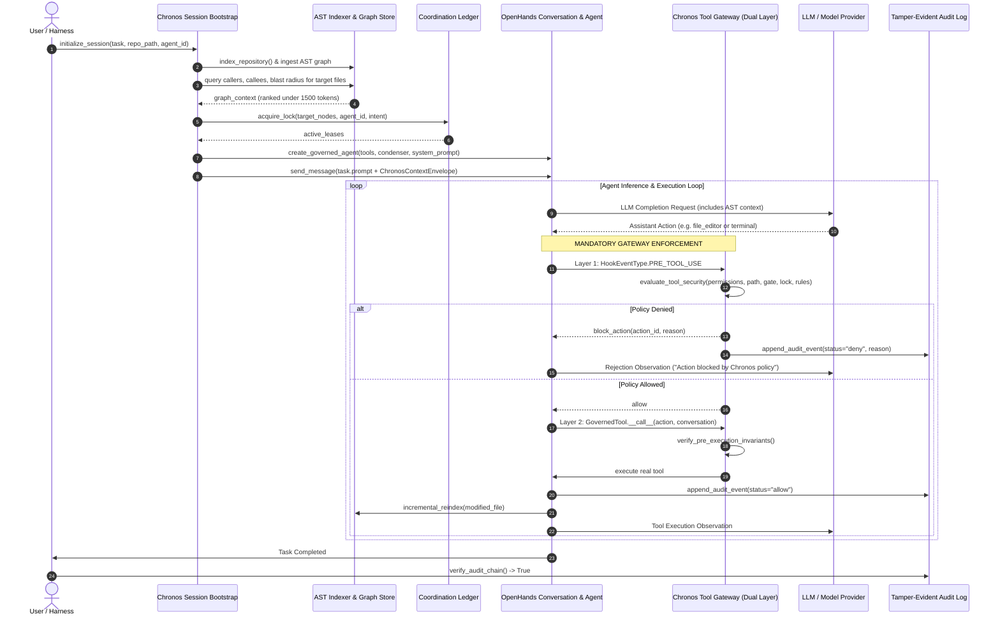

# Chronos: Mandatory Knowledge & Enforcement Architecture
## Target Architecture Specification

**Status:** Proposed Architecture  
**Target Runtime:** OpenHands SDK v1.58.2+  
**Core Design Philosophy:** Model-Agnostic, Fail-Closed, Bi-Temporal Knowledge, Dual-Layer Enforcement

---

## 1. Executive Overview & Architectural Principles

Chronos is not an autonomous coding agent, nor is it a model routing gateway. It is an **engineering knowledge and deterministic governance layer** that wraps agent runtimes to provide:

1. **Automatic, Mandatory Knowledge Injection**: Before an agent issues its first inference call, Chronos reconstructs repository intelligence (bi-temporal AST call graphs, callers, callees, transitive blast-radius impact, active rules, and coordination locks) and delivers it directly into the agent's context window without requiring the model to query tools or remember Chronos's existence.
2. **Mandatory, Fail-Closed Execution Control**: Every state-changing action (file edits, creations, deletions, renames, terminal commands, git operations) is deterministically authorized at both the OpenHands lifecycle hook boundary and the tool execution boundary. Denied operations are blocked pre-execution and recorded to a tamper-evident audit ledger.
3. **Model & Runtime Independence**: Governance policies, bi-temporal graph queries, and locking mechanics remain completely decoupled from specific model providers (Gemini, Claude, GPT, local weights) and agent runtimes (OpenHands, Claude Code, Cline, AutoGen).

```
+---------------------------------------------------------------------------------------------------+
|                                   EXTERNAL AI MODEL / LLM                                         |
|                       (Gemini 3.8 Flash, Claude 3.7 Sonnet, GPT-4o, Local)                        |
+---------------------------------------------------------------------------------------------------+
                                                  ^
                                                  | (Raw Completions & Tool Calls)
                                                  v
+---------------------------------------------------------------------------------------------------+
|                                     OPENHANDS AGENT RUNTIME                                       |
|                                                                                                   |
|  +---------------------------------------------------------------------------------------------+  |
|  |                            CHRONOS SESSION BOOTSTRAP MANAGER                                |  |
|  |   - Task target resolution     - Bi-temporal AST graph query     - Token-budgeted ranking   |  |
|  |   - Automated context packing  - Pre-turn prompt/context inject  - Atomic lease acquisition |  |
|  +---------------------------------------------------------------------------------------------+  |
|                                                  |                                                |
|  +-------------------------------+-------------------------------------------------------------+  |
|  |                     MANDATORY TOOL AUTHORIZATION GATEWAY (DUAL-LAYER)                       |  |
|  |                                                                                             |  |
|  |   [LAYER 1: OpenHands PreToolUse Hook]               [LAYER 2: Governed Tool Proxy]         |  |
|  |   - Event inspection & state.block_action            - Tool.__call__ wrapper proxy          |  |
|  |   - Emits rejection observation pre-exec             - Fails closed if Hook is bypassed     |  |
|  +-------------------------------+-------------------------------------------------------------+  |
|                                                  |                                                |
|  +-------------------------------+-------------------------------------------------------------+  |
|  |                             CHRONOS CONTEXT CONDENSER                                       |  |
|  |   - Invariant preservation (security & rules)        - Active AST lease renewal warnings    |  |
|  |   - AST summary anchoring across condensation        - Head/Tail token pruning              |  |
|  +---------------------------------------------------------------------------------------------+  |
+---------------------------------------------------------------------------------------------------+
                                                  |
                                                  v
+---------------------------------------------------------------------------------------------------+
|                                  DETERMINISTIC CHRONOS CORE ENGINE                                |
|                                                                                                   |
|  +-------------------------+  +--------------------------+  +----------------------------------+  |
|  |    KNOWLEDGE GRAPH      |  |    SECURITY ENGINE       |  |      COORDINATION LEDGER         |  |
|  |  - SQLite Bi-Temporal   |  |  - Path Sanitizer        |  |  - Sub-File AST Node Locks       |  |
|  |  - AST Callers/Callees  |  |  - Permission Manifests  |  |  - Atomic SQLite Leases (TTL)    |  |
|  |  - Blast Radius Impact  |  |  - Protected Gate YAML   |  |  - Multi-Agent Conflict Avoidance|  |
|  +-------------------------+  +--------------------------+  +----------------------------------+  |
|                                                                                                   |
|  +-------------------------+  +--------------------------+  +----------------------------------+  |
|  |   VERIFICATION ENGINE   |  |    AUDIT & TELEMETRY     |  |      OS / CONTAINER SANDBOX      |  |
|  |  - Deterministic Rules  |  |  - Append-Only SHA-256   |  |  - Read-Only Root Filesystem     |  |
|  |  - Blocking AST Checks  |  |  - Hash-Chained Log      |  |  - Masked .chronos Database      |  |
|  |  - Promote/Draft State  |  |  - Provenance Ledger     |  |  - Unprivileged User & No-Net    |  |
|  +-------------------------+  +--------------------------+  +----------------------------------+  |
+---------------------------------------------------------------------------------------------------+
```

---

## 2. Component Boundaries & Responsibilities

### 2.1 Chronos Session Bootstrap Manager
- **File Location:** `runtime/session.py` (New)
- **Role:** Coordinates the deterministic startup sequence before any inference call occurs.
- **Responsibilities:**
  - Ingests repository AST into `SQLiteGraphStore` if unindexed or dirty.
  - Resolves target files, seed symbols, and caller/callee trees within a 1,500-token budget.
  - Automatically acquires initial AST node leases in `chronos/coordination/ledger.py`.
  - Injects formatted context into:
    1. OpenHands `Conversation` via `SessionStart` hook (`inject_pending_additional_context`).
    2. Turn 1 Prompt Context Envelope (guaranteeing delivery even if system prompt is condensed).
  - Initializes `ChronosContextCondenser` with session security invariants and active lease IDs.

### 2.2 Dual-Layer Mandatory Authorization Gateway
To guarantee zero-bypass execution control, enforcement is placed at two distinct architectural checkpoints:

#### Layer 1: OpenHands PreToolUse Hook (Application Gateway)
- **File Location:** `runtime/hooks.py`
- **Role:** First line of defense. Integrates natively with OpenHands SDK `HookConfig`.
- **Mechanics:**
  - Evaluates `HookEventType.PRE_TOOL_USE` for every `ActionEvent`.
  - Calls `evaluate_tool_security(con, agent_id, tool_name, tool_input, repo_root)`.
  - On denial: calls `state.block_action(event.id, reason)`.
  - OpenHands SDK `_ActionBatch.prepare` reads `state.pop_blocked_action` and routes the event to a rejection observation, bypassing tool execution entirely.

#### Layer 2: Governed Tool Proxy (`ChronosToolGateway`) (Execution Chokepoint)
- **File Location:** `runtime/gateway.py` (New)
- **Role:** Second line of defense. Wraps every `Tool` passed to `Agent(tools=[...])`.
- **Mechanics:**
  - Implements the callable interface `tool(action, conversation)`.
  - Intercepts invocation at the Python execution boundary inside `Agent._execute_action_event`.
  - Independently queries `evaluate_tool_security`.
  - If Layer 1 was bypassed, disabled, or encountered a framework bug, Layer 2 **fails closed**, aborting the tool call, emitting an audit event, and raising a `ChronosSecurityException`.

### 2.3 Sub-File AST Locking & Intent Ledger
- **File Location:** `chronos/coordination/ledger.py`
- **Role:** Multi-agent concurrency and collision defense.
- **Mechanics:**
  - Granularity: `path::symbol::kind` (e.g. `src/auth.py::login_user::Function`).
  - Atomic acquisition via SQLite `BEGIN IMMEDIATE` transactions.
  - Expiring lease TTL (default 300s) preventing crashed-agent deadlocks.
  - Inferred Locks: When an agent attempts to edit a file containing functions, Chronos infers the enclosing AST node and verifies that no other agent holds an active lease on that node.

### 2.4 Context Preservation Condenser
- **File Location:** `runtime/condenser.py`
- **Role:** Token budgeting without losing critical governance state.
- **Mechanics:**
  - Subclasses OpenHands SDK `CondenserBase`.
  - Identifies and anchors:
    1. Initial security invariants and permission manifests.
    2. Active AST node lock records and lease expiration timestamps.
    3. Blocking verification rules.
  - Condenses historical intermediate tool observations while re-injecting active lock statuses to prevent stale write attempts.

### 2.5 OS & Container Sandbox (Terminal Boundary)
- **File Location:** `chronos/sandbox/container.py` (Design)
- **Role:** Defends against arbitrary shell execution (`TerminalTool`, subprocesses).
- **Guarantees:**
  - Application code cannot reliably parse arbitrary bash syntax (`sh -c "eval $(...) "` ).
  - Chronos mandates container/jail isolation:
    - `.chronos/` directory is mounted `ro` or hidden via tmpfs overlay, preventing direct tampering with `chronos.db` or audit logs.
    - Root filesystem `/` mounted read-only.
    - Workspace mounted `rw` with no-exec on temporary directories.
    - Unprivileged UID (non-root) execution.

---

## 3. End-to-End Lifecycle: Task Initialization to Completion



---

## 4. Architectural Invariants (Non-Negotiable)

1. **Fail-Closed by Default (`INV-01`)**: If any policy check, database query, AST parser, or hook crashes or times out, the action is **DENIED** (`exit 2`, `state.block_action`, `PermissionError`). OpenHands SDK's default "fall-open" behavior is explicitly intercepted and overridden.
2. **Context Delivery before Turn 1 (`INV-02`)**: No LLM completion request may be dispatched until the target symbols, callers, callees, and active rules are assembled and injected into the conversation view.
3. **Dual-Layer Tool Guarding (`INV-03`)**: Every tool registered on an agent must be wrapped by `ChronosToolGateway`. No raw SDK tool may be exposed directly to the model.
4. **Node-Level Mutual Exclusion (`INV-04`)**: No file write or edit may proceed if another agent holds an unexpired lease on the target AST node.
5. **Tamper-Evident Provenance (`INV-05`)**: Every authorization decision (allow or deny), lease transition, and rule violation must be cryptographically hashed and appended to `chronos-audit.log` before tool execution begins.
