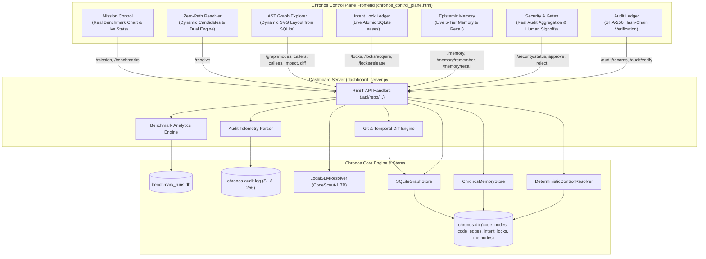

# Implementation Plan — Wire Chronos Control Plane UI to Real Subsystems

## Goal Description
The current Chronos Control Plane dashboard (`chronos/server/chronos_control_plane.html` and `chronos/server/dashboard_server.py`) has placeholder and simulated logic across several key areas:
1. Synthetic benchmark curves (`Math.sin(...)`) instead of reading genuine benchmark data.
2. Hardcoded token savings percentages (`78.2%`) and resolver latencies (`12.4ms`).
3. Static SVG AST call graph with 4 fixed nodes instead of dynamically rendering real nodes and dependencies from `SQLiteGraphStore`.
4. Hardcoded candidate score breakdown in the Zero-Path Resolver instead of real signal ranking weights.
5. Inactive SLM backend toggle (`LocalSLMResolver` is not executed when enabled).
6. Hardcoded security gate metrics (`1,284 evaluated`, `17 denied`) instead of aggregating genuine events from `chronos-audit.log`.
7. Hardcoded mock table rows and fake namespaces in Epistemic Memory and Intent Lock views.
8. Simulated temporal commit diff (`compareGitCommits()` shows a mock toast).

This plan outlines the end-to-end wiring of the UI directly to real Chronos database tables, actual benchmark datasets, dynamic SVG graph layout, `LocalSLMResolver`, live audit telemetry, and git commit history.

---

## User Review Required

> [!IMPORTANT]
> **Key Decisions Aligned With User Choices:**
> 1. **Benchmark Data**: Mission Control will load paired task token counts and duration metrics directly from `benchmarks/data/benchmark_runs.db` (and summary JSONs), updating the bar chart and cumulative token savings dynamically.
> 2. **Procedural AST Graph**: The SVG graph canvas will be dynamically rendered using a custom, dependency-free procedural SVG radial/directed layout that visualizes the inspected node, its real callers, callees, and depth-bounded blast-radius nodes.
> 3. **Dual-Engine Resolver**: The Zero-Path resolver backend will support both the fast deterministic AST+BM25 engine and `LocalSLMResolver`, passing real candidate signal breakdowns to the frontend.
> 4. **Live Audit & Temporal Diff**: Security stats will be dynamically computed from `chronos-audit.log`, and the temporal diff view will query real git commit history and `as_of_diff`.

---

## Proposed Changes



---

### Backend Components (`chronos/server/`)

#### [MODIFY] `chronos/server/dashboard_server.py`
1. **Benchmark Telemetry Engine**:
   - Add handler `_handle_benchmarks(repo, limit)` querying `benchmarks/data/benchmark_runs.db`.
   - Calculate paired baseline vs treatment total token metrics, latency deltas, and task-by-task paired results for the 24 SWE-bench tasks.
   - Dynamically compute `token_savings_pct` and mean duration from real runs, replacing hardcoded `78.2%`.
2. **Rolling Resolver Latency**:
   - Maintain a thread-safe rolling window of recent resolution times to report live `resolver_latency_ms`.
3. **Dual-Engine Zero-Path Resolver Execution**:
   - Wire `body.get("enable_slm")`:
     - When true: Invoke `LocalSLMResolver(repo_root=Path(repo.root))` with circuit breaker protection, fusing SLM suspected files/symbols with `DeterministicContextResolver` candidates.
     - Return actual candidate score breakdown (`exact_match`, `path_similarity`, `fts5_bm25`, `test_colocated`, `slm_bonus`).
4. **Dynamic Security Telemetry Aggregator**:
   - Parse `chronos-audit.log` to compute actual metrics:
     - `evaluated_count`: total audit events evaluated.
     - `denied_count`: events with status `DENY`.
     - `signoffs_count`: count of `gate_approval` events.
     - `boundary_intercepts`: count of policy violation / boundary intercept events.
5. **Git Commit History & Temporal Diff Handler**:
   - Enhance `_handle_graph_diff` to accept git revisions or timestamps.
   - Add endpoint `_handle_git_commits(repo, count)` to return the recent commit history (`git log -n 15`) so users can compare arbitrary commits.

---

### Frontend Components (`chronos/server/chronos_control_plane.html`)

#### [MODIFY] `chronos/server/chronos_control_plane.html`
1. **Real Benchmark Chart Rendering**:
   - Replace `Math.sin(...)` in `renderChart()` with an asynchronous fetch to `/api/repo/{id}/benchmarks?limit={count}`.
   - Render real task names (e.g. `cng_task_01`, `chronos_task_02`), real baseline token bars, and treatment token bars with exact percentage reductions.
2. **Dynamic Procedural SVG AST Graph Explorer**:
   - Replace static `<circle>` nodes with an SVG procedural layout engine:
     - Central primary node with styling based on kind (`CLASS`, `METHOD`, `FUNCTION`).
     - Upstream caller nodes positioned radially or to the left with directional SVG link curves.
     - Downstream callee nodes positioned to the right with dependency arrows.
     - Blast radius nodes colored by depth when expanding transitive impact.
     - Clickable node entities that trigger live inspection without page reloads.
3. **Zero-Path Candidate Scoring Table**:
   - Replace the hardcoded signal table in `#page-resolver` with dynamic candidate cards showing real scoring factors (BM25 score, path similarity, exact symbol matches, co-located test bonuses).
   - Display SLM domain concepts, intent classification, and rationale when SLM engine is selected.
4. **Temporal Diff & Git Commit Selector**:
   - Replace the static diff table with dynamic commit selectors (`Base Commit` vs `Target Commit`).
   - Call `/api/repo/{id}/graph/diff` and display genuine added, modified, and removed symbols and edges.
5. **Remove Hardcoded Markup Fallbacks**:
   - Clean out hardcoded mock rows in `#lockTable`, `#memoryGrid`, and initial security stat blocks so the interface displays clean skeletons or empty states before live data loads.
   - Populate Epistemic Memory namespaces dynamically from `stats.namespaces`.

---

### Test Suite (`tests/`)

#### [MODIFY] `tests/test_ui_server.py`
- Add integration tests for new endpoints:
  - `test_benchmarks_endpoint_returns_real_runs`: Verifies `/api/repo/.../benchmarks` parses paired runs.
  - `test_resolve_with_slm_toggle`: Verifies dual-engine resolver request dispatching.
  - `test_security_status_aggregates_audit_log`: Verifies accurate counts from test audit log fixtures.
  - `test_graph_temporal_diff_and_commits`: Verifies commit listing and temporal graph diff payloads.

---

## Verification Plan

### Automated Tests
1. **Targeted UI Server Tests**:
   ```bash
   .venv/bin/pytest tests/test_ui_server.py -v
   ```
2. **Whole Repository Test Suite**:
   ```bash
   .venv/bin/pytest tests/
   ```

### Manual Verification
1. Open **[http://127.0.0.1:8765](http://127.0.0.1:8765)**.
2. **Mission Control**: Verify the bar chart displays actual benchmark tasks (`cng_task_*`, `chronos_task_*`), real token heights, and genuine cumulative token savings (~59.6%).
3. **Zero-Path Resolver**: Enter a natural prompt (e.g., *"Prevent race condition in lock ledger"*), test both Deterministic AST and SLM toggles, and verify dynamic candidate scoring breakdown.
4. **AST Graph Explorer**: Search for `SQLiteGraphStore.ingest`, verify that SVG renders actual caller/callee nodes and blast radius edges dynamically.
5. **Intent Lock Ledger**: Acquire a lease on a real symbol, verify it shows in the table and adds an entry to `chronos-audit.log`.
6. **Epistemic Memory**: Remember a new invariant, verify it appears in the grid, and test semantic search.
7. **Security & Gates**: Verify tool request counters match `chronos-audit.log`.
8. **Audit Ledger**: Click "Verify Hash Chain" and observe cryptographic verification.
