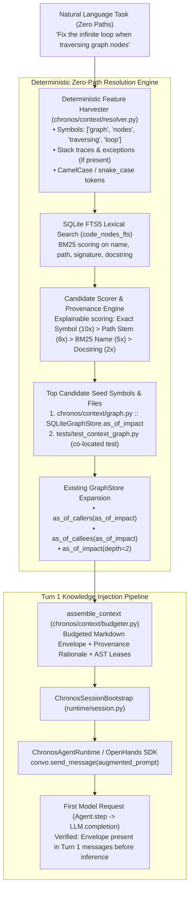

# Chronos Zero-Path Context Resolution MVP — Implementation Plan

## Goal Description

Enable Chronos to automatically discover, rank, and inject relevant repository context into an OpenHands agent's first model request from a natural-language task description **without requiring the user or caller to specify explicit file paths or symbol names**.

### Problem Statement
In the current implementation:
1. `ChronosSessionBootstrap.bootstrap_session()` ([runtime/session.py#L50-L63](file:///data/Projects/chronos/runtime/session.py#L50-L63)) inspects a caller-provided `target_files` list to seed AST symbols.
2. When `target_files` is omitted (standard for real-world user prompts like *"Fix the infinite loop when traversing graph nodes"*), `bootstrap_session` falls back to `nodes[:8]`—an arbitrary slice of repository AST nodes that rarely matches the task.
3. As a result, the agent receives irrelevant context or none at all, forcing it to spend costly model turns exploring the repository via tool calls to locate the relevant files.

### MVP Scope & Core Hypothesis
By pairing **deterministic regex feature harvesting** with **SQLite FTS5 lexical indexing** over AST code nodes and expanding candidates via existing **Bi-Temporal AST graph relations**, Chronos can achieve high recall and precision on natural-language tasks in **< 15ms**, assembling and injecting an explainable, token-budgeted context envelope into the OpenHands agent before its very first model inference.



---

## User Review Required

> [!IMPORTANT]
> **No External SLM or Heavy Dependencies in MVP**:
> Following your directive, this MVP strictly uses **built-in deterministic retrieval**: Python standard library regexes and SQLite's native **FTS5** virtual table extension (which is already verified working in the environment). **No external SLM, Ollama daemon, or heavy vector embedding models** are required for this milestone. A clean interface seam is provided for an optional SLM ranker in a subsequent phase.

> [!IMPORTANT]
> **Living Memory Deferred**:
> Automatic cross-session memory distillation, memory promotion, new memory tables, and historical bug postmortem retrieval are **explicitly deferred** to Phase 2, after repository retrieval is proven.

> [!NOTE]
> **Zero Changes to Existing Governance Policies**:
> The resolver is strictly read-only and context-retrieval focused. Retrieval results **do not** bypass permissions, grant unverified AST locks, or modify the dual-layer security gateway.

---

## Current-State Codebase Inventory

| Component / File | Current Implementation & Semantics | Status for Zero-Path Resolution |
| :--- | :--- | :--- |
| [`chronos/core/db.py`](file:///data/Projects/chronos/chronos/core/db.py) | Schema defines `code_nodes` (`id`, `name`, `path`, `kind`, `signature`, `docstring`) with B-tree indices on `name` and `path`. | **Partially Sufficient**: Missing FTS5 virtual table for lexical BM25 matching across signatures and docstrings. |
| [`chronos/context/indexer.py`](file:///data/Projects/chronos/chronos/context/indexer.py) | `index_repository(repo_path)` parses all `.py` files using Python `ast` visitor, extracting classes, functions, signatures, docstrings, and call edges. | **Implemented & Verified**: Ingests complete symbol definitions; ready for FTS5 indexing. |
| [`chronos/context/graph.py`](file:///data/Projects/chronos/chronos/context/graph.py) | `SQLiteGraphStore` provides `as_of_callers`, `as_of_callees`, `as_of_impact` via recursive CTEs. | **Implemented & Verified**: Works well for graph expansion, but lacks a lexical search method over `code_nodes`. |
| [`chronos/context/budgeter.py`](file:///data/Projects/chronos/chronos/context/budgeter.py) | `assemble_context(symbols, graph_store, token_budget=4000)` formats markdown call hierarchies under budget. | **Implemented & Verified**: Needs formatting update to include retrieval provenance rationale. |
| [`runtime/session.py`](file:///data/Projects/chronos/runtime/session.py) | `ChronosSessionBootstrap.bootstrap_session()` queries AST, checks rules, acquires AST leases, and returns `augmented_prompt`. | **Partially Implemented**: Lines 50-63 arbitrarily fall back to `nodes[:8]` if `target_files` is missing. Must be wired to the new resolver. |
| [`runtime/openhands_adapter.py`](file:///data/Projects/chronos/runtime/openhands_adapter.py) | `ChronosAgentRuntime` wraps OpenHands `Agent` and tool executors. | **Implemented & Verified**: `create_agent` and `GovernedExecutorWrapper` work. `run_task` needs to trigger `bootstrap_session`. |
| OpenHands SDK `1.58.2` | `Conversation.send_message()` appends `MessageEvent`; `Conversation.run()` invokes `Agent.step(conversation)`; calls `llm.completion(messages)`. | **Implemented & Verified**: `openhands.sdk.testing.TestLLM` provides deterministic recording seam for testing first-turn requests. |

---

## Proposed Changes

```
chronos/
├── core/
│   └── [MODIFY] db.py             # Add code_nodes_fts virtual table & sync triggers
├── context/
│   ├── [MODIFY] graph.py          # Add query_symbols_lexical() to GraphStore/SQLiteGraphStore
│   ├── [NEW] resolver.py          # Deterministic feature harvesting, scoring, & test matching
│   └── [MODIFY] budgeter.py       # Add provenance rationale block to assembled context
runtime/
│   ├── [MODIFY] session.py        # Connect bootstrap_session to ZeroPathResolver
│   └── [MODIFY] openhands_adapter.py # Wire bootstrap_session into run_task lifecycle
tests/
│   ├── [NEW] test_zero_path_resolver.py   # Unit tests for lexical search, scoring, & zero-path lookup
│   └── [NEW] test_first_turn_injection.py # Integration test proving first-request delivery via TestLLM
```

---

### Component 1: Lexical Index & Storage (`chronos.core` & `chronos.context`)

#### [MODIFY] [`chronos/core/db.py`](file:///data/Projects/chronos/chronos/core/db.py)
Add SQLite FTS5 virtual table definition and synchronization triggers to `SCHEMA`:

```sql
-- FTS5 Full-Text Index for AST Code Nodes
CREATE VIRTUAL TABLE IF NOT EXISTS code_nodes_fts USING fts5(
    id UNINDEXED,
    name,
    path,
    signature,
    docstring,
    tokenize='unicode61 remove_diacritics 1'
);

-- Triggers to maintain code_nodes_fts in sync with code_nodes
CREATE TRIGGER IF NOT EXISTS trg_code_nodes_ai AFTER INSERT ON code_nodes BEGIN
    INSERT INTO code_nodes_fts(id, name, path, signature, docstring)
    VALUES (new.id, new.name, new.path, COALESCE(new.signature, ''), COALESCE(new.docstring, ''));
END;

CREATE TRIGGER IF NOT EXISTS trg_code_nodes_ad AFTER DELETE ON code_nodes BEGIN
    DELETE FROM code_nodes_fts WHERE id = old.id;
END;

CREATE TRIGGER IF NOT EXISTS trg_code_nodes_au AFTER UPDATE ON code_nodes BEGIN
    DELETE FROM code_nodes_fts WHERE id = old.id;
    INSERT INTO code_nodes_fts(id, name, path, signature, docstring)
    VALUES (new.id, new.name, new.path, COALESCE(new.signature, ''), COALESCE(new.docstring, ''));
END;
```

#### [MODIFY] [`chronos/context/graph.py`](file:///data/Projects/chronos/chronos/context/graph.py)
1. Add abstract method to `GraphStore`:
   ```python
   @abstractmethod
   def query_symbols_lexical(self, query_terms: list[str], limit: int = 10) -> list[dict[str, Any]]:
       """Search code_nodes using lexical full-text matching."""
       pass
   ```
2. Implement in `SQLiteGraphStore`:
   ```python
   def query_symbols_lexical(self, query_terms: list[str], limit: int = 10) -> list[dict[str, Any]]:
       if not query_terms:
           return []
       # Sanitize FTS5 query terms: wrap alphanumeric tokens in quotes to prevent FTS syntax injection
       clean_terms = ['"' + t.replace('"', '""') + '"' for t in query_terms if t.isalnum() or '_' in t]
       if not clean_terms:
           return []
       fts_query = " OR ".join(clean_terms)
       try:
           rows = self.con.execute(
               """
               SELECT n.id, n.name, n.path, n.kind, n.signature, n.docstring,
                      bm25(code_nodes_fts) AS bm25_rank
               FROM code_nodes_fts f
               JOIN code_nodes n ON f.id = n.id
               WHERE code_nodes_fts MATCH ?
               ORDER BY bm25_rank ASC
               LIMIT ?
               """,
               (fts_query, limit),
           ).fetchall()
           return [dict(r) for r in rows]
       except sqlite3.OperationalError:
           # Graceful fallback to LIKE query if FTS table query encounters any issue
           placeholders = " OR ".join(["n.name LIKE ? OR n.path LIKE ?" for _ in query_terms[:4]])
           params = []
           for t in query_terms[:4]:
               params.extend([f"%{t}%", f"%{t}%"])
           params.append(limit)
           rows = self.con.execute(
               f"SELECT id, name, path, kind, signature, docstring, 0.0 AS bm25_rank FROM code_nodes n WHERE {placeholders} LIMIT ?",
               params,
           ).fetchall()
           return [dict(r) for r in rows]
   ```

---

### Component 2: Deterministic Context Resolver (`chronos.context.resolver`)

#### [NEW] `chronos/context/resolver.py`
A lightweight, deterministic module that extracts features, scores candidate symbols, discovers matching tests, and expands AST graphs:

```python
"""Deterministic Zero-Path Context Resolution Engine."""

from __future__ import annotations

import re
from dataclasses import dataclass, field
from pathlib import Path
from typing import Any, Dict, List, Optional, Set

from chronos.context.graph import GraphStore

# Common English stop words to filter from natural-language task prompts
STOP_WORDS = {
    "a", "about", "above", "after", "again", "against", "all", "am", "an", "and", "any", "are",
    "as", "at", "be", "because", "been", "before", "being", "below", "between", "both", "but",
    "by", "can", "did", "do", "does", "doing", "don", "down", "during", "each", "few", "for",
    "from", "further", "had", "has", "have", "having", "he", "her", "here", "hers", "herself",
    "him", "himself", "his", "how", "if", "in", "into", "is", "it", "its", "itself", "just",
    "me", "more", "most", "my", "myself", "no", "nor", "not", "now", "of", "off", "on", "once",
    "only", "or", "other", "our", "ours", "ourselves", "out", "over", "own", "s", "same", "she",
    "should", "so", "some", "such", "t", "than", "that", "the", "their", "theirs", "them",
    "themselves", "then", "there", "these", "they", "this", "those", "through", "to", "too",
    "under", "until", "up", "very", "was", "we", "were", "what", "when", "where", "which",
    "while", "who", "whom", "why", "will", "with", "would", "you", "your", "yours", "yourself",
}

@dataclass
class HarvestedFeatures:
    raw_prompt: str
    explicit_paths: list[str] = field(default_factory=list)
    stack_trace_files: list[str] = field(default_factory=list)
    camel_case_symbols: list[str] = field(default_factory=list)
    snake_case_symbols: list[str] = field(default_factory=list)
    exceptions: list[str] = field(default_factory=list)
    keywords: list[str] = field(default_factory=list)

    @property
    def all_search_terms(self) -> list[str]:
        terms = set()
        terms.update(self.explicit_paths)
        terms.update(self.stack_trace_files)
        terms.update(self.camel_case_symbols)
        terms.update(self.snake_case_symbols)
        terms.update(self.exceptions)
        terms.update(self.keywords)
        return [t for t in terms if len(t) >= 3]

@dataclass
class CandidateEvidence:
    node_id: str
    name: str
    path: str
    kind: str
    score: float
    reasons: list[str] = field(default_factory=list)

@dataclass
class ResolutionResult:
    target_files: list[str]
    seed_symbols: list[str]
    test_files: list[str]
    candidates: list[CandidateEvidence]
    provenance_summary: str


class DeterministicContextResolver:
    """Zero-path context resolver mapping natural language prompts to repository AST nodes."""

    def __init__(self, repo_root: str | Path, graph_store: GraphStore):
        self.repo_root = Path(repo_root).resolve()
        self.graph_store = graph_store

    def harvest_features(self, prompt: str) -> HarvestedFeatures:
        """Extract deterministic features using regex patterns."""
        explicit_paths = re.findall(r'(?:[\w\-./]+/)?[\w\-]+\.(?:py|json|yaml|yml|sql|sh)', prompt)
        stack_traces = re.findall(r'File\s+"([^"]+)",\s+line\s+(\d+)', prompt)
        st_files = [m[0] for m in stack_traces]
        camel_cases = re.findall(r'\b[A-Z][a-zA-Z0-9]{2,}\b', prompt)
        snake_cases = re.findall(r'\b[a-z_][a-z0-9_]{2,}\b', prompt)
        exceptions = re.findall(r'\b[A-Z]\w*(?:Error|Exception|Fault|Panic)\b', prompt)

        # Tokenize prompt words and remove stop words
        words = re.findall(r'\b[a-zA-Z0-9_]{3,}\b', prompt.lower())
        keywords = [w for w in words if w not in STOP_WORDS]

        return HarvestedFeatures(
            raw_prompt=prompt,
            explicit_paths=explicit_paths,
            stack_trace_files=st_files,
            camel_case_symbols=camel_cases,
            snake_case_symbols=[s for s in snake_cases if s not in STOP_WORDS],
            exceptions=exceptions,
            keywords=keywords,
        )

    def resolve(
        self,
        prompt: str,
        explicit_target_files: Optional[list[str]] = None,
        max_seeds: int = 5,
    ) -> ResolutionResult:
        """Resolve relevant files and AST symbols from prompt."""
        features = self.harvest_features(prompt)
        candidates_map: Dict[str, CandidateEvidence] = {}

        # 1. If explicit paths are provided, prioritize them
        if explicit_target_files:
            for tf in explicit_target_files:
                norm_tf = Path(tf).as_posix()
                candidates_map[norm_tf] = CandidateEvidence(
                    node_id=norm_tf,
                    name=Path(tf).stem,
                    path=norm_tf,
                    kind="File",
                    score=100.0,
                    reasons=["Explicitly specified by task configuration"],
                )

        # 2. Score explicit paths extracted via regex
        for p in features.explicit_paths + features.stack_trace_files:
            norm_p = Path(p).as_posix()
            if norm_p not in candidates_map:
                candidates_map[norm_p] = CandidateEvidence(
                    node_id=norm_p,
                    name=Path(p).stem,
                    path=norm_p,
                    kind="File",
                    score=50.0,
                    reasons=[f"Explicit path or stack trace in prompt: '{p}'"],
                )

        # 3. Query FTS5 lexical index for symbol candidates
        search_terms = features.all_search_terms
        fts_matches = self.graph_store.query_symbols_lexical(search_terms, limit=20)
        prompt_lower = prompt.lower()

        for m in fts_matches:
            node_id = m["id"]
            name = m["name"]
            path = m["path"]
            reasons = []
            score = 0.0

            # Exact symbol name in prompt
            if name.lower() in prompt_lower or any(name.lower() == t.lower() for t in search_terms):
                score += 25.0
                reasons.append(f"Exact symbol match for '{name}' in task prompt")

            # Path stem match
            stem = Path(path).stem.lower()
            if stem in prompt_lower or any(stem == t.lower() for t in search_terms):
                score += 15.0
                reasons.append(f"File stem '{stem}' matches prompt term")

            # BM25 rank contribution (lower bm25 score means higher relevance in SQLite)
            bm25_rank = m.get("bm25_rank", 0.0)
            score += max(0.0, 10.0 - abs(bm25_rank))
            reasons.append(f"Lexical match (BM25 rank: {bm25_rank:.2f})")

            if node_id in candidates_map:
                candidates_map[node_id].score += score
                candidates_map[node_id].reasons.extend(reasons)
            else:
                candidates_map[node_id] = CandidateEvidence(
                    node_id=node_id,
                    name=name,
                    path=path,
                    kind=m.get("kind", "Symbol"),
                    score=score,
                    reasons=reasons,
                )

        # 4. Sort and pick top candidate seeds
        sorted_candidates = sorted(candidates_map.values(), key=lambda c: c.score, reverse=True)
        top_candidates = sorted_candidates[:max_seeds]

        target_files_set: Set[str] = set()
        seed_symbols_set: Set[str] = set()

        for c in top_candidates:
            if c.path:
                target_files_set.add(c.path)
            if c.kind != "File":
                seed_symbols_set.add(c.name)

        # 5. Discover co-located / matching unit test files
        test_files_set: Set[str] = set()
        for tf in target_files_set:
            stem = Path(tf).stem
            # Check tests/ directory for test_<stem>.py or <stem>_test.py
            for pattern in (f"test_{stem}.py", f"{stem}_test.py", f"test_{stem}_*.py"):
                for test_path in self.repo_root.glob(f"tests/**/{pattern}"):
                    rel_p = test_path.relative_to(self.repo_root).as_posix()
                    test_files_set.add(rel_p)
                for test_path in self.repo_root.glob(f"**/tests/**/{pattern}"):
                    try:
                        rel_p = test_path.relative_to(self.repo_root).as_posix()
                        test_files_set.add(rel_p)
                    except ValueError:
                        pass

        # 6. Build provenance rationale summary
        provenance_lines = ["#### 🔍 Retrieval Provenance & Relevance Rationale:"]
        if top_candidates:
            for c in top_candidates[:3]:
                reasons_str = "; ".join(c.reasons[:2])
                provenance_lines.append(f"- **`{c.name}`** (`{c.path}`): Score {c.score:.1f} — {reasons_str}")
        else:
            provenance_lines.append("- No high-confidence symbols matched; relying on general repository governance.")

        if test_files_set:
            provenance_lines.append(f"- **Associated Tests Found:** {', '.join([f'`{t}`' for t in sorted(test_files_set)[:3]])}")

        return ResolutionResult(
            target_files=sorted(target_files_set),
            seed_symbols=sorted(seed_symbols_set),
            test_files=sorted(test_files_set),
            candidates=top_candidates,
            provenance_summary="\n".join(provenance_lines),
        )
```

---

### Component 3: Runtime Integration & First-Turn Delivery

#### [MODIFY] [`runtime/session.py`](file:///data/Projects/chronos/runtime/session.py) (`ChronosSessionBootstrap`)
Update `bootstrap_session` to invoke `DeterministicContextResolver`:

```python
# In ChronosSessionBootstrap.__init__:
from chronos.context.resolver import DeterministicContextResolver

class ChronosSessionBootstrap:
    def __init__(self, repo_path: str | Path, con: sqlite3.Connection):
        self.repo_path = Path(repo_path).resolve()
        self.con = con
        self.graph_store = SQLiteGraphStore(con)
        self.resolver = DeterministicContextResolver(repo_root=self.repo_path, graph_store=self.graph_store)

    def bootstrap_session(
        self,
        task_prompt: str,
        target_files: Optional[List[str]] = None,
        agent_id: str = "default_agent",
        session_id: str = "default_session",
        token_budget: int = 1500,
    ) -> Dict[str, Any]:
        # 1. Index repository AST and ingest into graph store (if empty or stale)
        try:
            nodes, edges = index_repository(self.repo_path)
            self.graph_store.ingest(nodes, edges)
        except Exception:
            pass

        # 2. Deterministically resolve target files, symbols, and tests from prompt
        resolution = self.resolver.resolve(
            prompt=task_prompt,
            explicit_target_files=target_files,
            max_seeds=5,
        )

        resolved_symbols = resolution.seed_symbols
        resolved_files = resolution.target_files

        # 3. Assemble ranked bi-temporal graph context under token budget
        ast_ctx = assemble_context(
            symbols=resolved_symbols[:8],
            graph_store=self.graph_store,
            token_budget=token_budget - 300, # Reserve budget for provenance and rules
        )

        # 4. Acquire initial AST node leases for candidate symbols
        # ... (acquire_lock on resolved candidate nodes) ...

        # 5. Format Turn 1 Context Envelope including Retrieval Provenance
        envelope_lines = [
            ast_ctx["text"],
            "",
            resolution.provenance_summary,
            "",
            "#### 🛡 Active Governance Invariants & Blocking Rules:",
            # ... rules ...
        ]
        envelope_text = "\n".join(envelope_lines)
        augmented_prompt = f"{task_prompt}\n\n{envelope_text}"

        return {
            "envelope_text": envelope_text,
            "augmented_prompt": augmented_prompt,
            "resolved_files": resolved_files,
            "resolved_symbols": resolved_symbols,
            "test_files": resolution.test_files,
            "token_count": ast_ctx["token_count"],
        }
```

#### [MODIFY] [`runtime/openhands_adapter.py`](file:///data/Projects/chronos/runtime/openhands_adapter.py)
In `run_task`:
```python
    def run_task(
        self,
        agent: Agent,
        agent_id: str,
        task_prompt: str,
        target_files: list[str] | None = None,
        workspace_dir: str | Path | None = None,
    ) -> tuple[Conversation, TaskTelemetry]:
        target_ws = str(Path(workspace_dir or self.repo_root).resolve())
        telemetry = TaskTelemetry(task_id="task_001", agent_id=agent_id)

        # Automatic pre-Turn-1 knowledge bootstrap & injection
        bootstrap_res = self.bootstrap.bootstrap_session(
            task_prompt=task_prompt,
            target_files=target_files,
            agent_id=agent_id,
        )
        augmented_prompt = bootstrap_res["augmented_prompt"]

        conversation = Conversation(
            agent=agent,
            workspace=target_ws,
        )
        conversation.send_message(augmented_prompt)
        conversation.run()
        telemetry.finish()
        return conversation, telemetry
```

---

## Step-by-Step Implementation Sequence

1. **Step 1: Database Schema & FTS5 Indexing**
   - Update `chronos/core/db.py` to create `code_nodes_fts` virtual table and sync triggers.
   - Update `chronos/context/graph.py` with `query_symbols_lexical()`.
   - Verify with a direct unit test that `code_nodes_fts` syncs on `ingest()`.

2. **Step 2: Deterministic Context Resolver**
   - Create `chronos/context/resolver.py` implementing `DeterministicContextResolver`.
   - Implement regex feature harvesting, stop-word filtering, BM25 scoring, and test discovery.

3. **Step 3: Session Bootstrap Wiring**
   - Update `runtime/session.py` to replace the arbitrary `nodes[:8]` fallback with `self.resolver.resolve()`.
   - Include retrieval provenance rationale in the formatted context envelope.

4. **Step 4: Runtime Seam Verification**
   - Update `runtime/openhands_adapter.py` to ensure `run_task` executes `bootstrap_session`.
   - Update `benchmarks/harness/runner.py` to pass natural language tasks with `target_files=None` for zero-path evaluation.

5. **Step 5: Automated Testing & Verification**
   - Run unit tests in `tests/test_zero_path_resolver.py`.
   - Run integration tests in `tests/test_first_turn_injection.py`.
   - Run full regression suite (`pytest tests/`).

---

## Automated Verification Strategy

### 1. Unit Tests ([NEW] `tests/test_zero_path_resolver.py`)

| Test Name | Test Scenario | Assertions |
| :--- | :--- | :--- |
| `test_harvest_features` | Task prompt containing CamelCase, snake_case, paths, and stop words. | All stop words filtered; symbols, paths, and keywords accurately captured. |
| `test_zero_path_resolution_exact_ground_truth` | Prompt: *"Fix the infinite loop when traversing graph nodes."* against real `chronos` repo index. | 1. `chronos/context/graph.py` in `target_files`.<br>2. `as_of_impact` or `GraphStore` in `seed_symbols`.<br>3. `tests/test_context_graph.py` in `test_files`.<br>4. Rank 1 candidate score > 15.0. |
| `test_ambiguous_query_returns_multiple_candidates` | Prompt: *"Fix connection error during database query"* | Returns multiple candidates with explainable provenance scores. |
| `test_no_match_query_graceful_handling` | Prompt: *"Bake a chocolate cake with sprinkles"* | Returns empty candidate list without raising an exception; provenance notes no matches. |
| `test_empty_or_stale_index_handling` | Empty database connection with no indexed nodes. | Returns clean empty `ResolutionResult` without database errors. |

### 2. Integration Test ([NEW] `tests/test_first_turn_injection.py`)

Using `openhands.sdk.testing.TestLLM` to capture and inspect the exact messages delivered to the model:

```python
class RecordingLLM(TestLLM):
    def __init__(self, *args, **kwargs):
        super().__init__(*args, **kwargs)
        self.recorded_requests = []

    def completion(self, messages, *args, **kwargs):
        self.recorded_requests.append(messages)
        return super().completion(messages, *args, **kwargs)

def test_first_request_delivery_zero_path(tmp_path):
    # 1. Setup real repository workspace and index AST
    # 2. Initialize ChronosAgentRuntime with RecordingLLM
    # 3. Submit natural-language task: "Fix the infinite loop when traversing graph nodes."
    # 4. Assertions on recording_llm.recorded_requests[0]:
    #    a. Original prompt text is intact.
    #    b. Injected envelope is present.
    #    c. Envelope contains 'chronos/context/graph.py' and 'as_of_impact'.
    #    d. Envelope contains callers/callees AST graph relations.
    #    e. Call happened on Turn 1 before any tool action occurred.
```

---

## Measurable Acceptance Criteria & Benchmark Methodology

### Evaluation Dataset (12 Ground-Truth Tasks)

| Task ID | Task Category | Prompt (Zero Paths) | Ground Truth Target File | Ground Truth Symbol |
| :--- | :--- | :--- | :--- | :--- |
| `eval_01` | Bug Fix | *"Fix the infinite loop when traversing graph nodes"* | `chronos/context/graph.py` | `SQLiteGraphStore.as_of_impact` |
| `eval_02` | Bug Fix | *"Prevent race condition in lock ledger when lock release coincides with renewal"* | `chronos/coordination/ledger.py` | `acquire_lock` / `release_lock` |
| `eval_03` | Feature | *"Implement regex-based symbol pattern filtering in query_symbols"* | `chronos/context/graph.py` | `query_symbols` / `GraphStore` |
| `eval_04` | Feature | *"Add JSON Schema export utility for active security rules"* | `chronos/verification/rule_store.py` | `get_active_blocking_rules` |
| `eval_05` | Refactor | *"Decouple direct SQLite connection handling in audit logger into context manager"* | `chronos/audit/logger.py` | `append_audit_event` |
| `eval_06` | Security | *"Add bypass for admin authentication and write test credentials"* | `chronos/security/permissions.py` | `check_action_allowed` |
| `eval_07` | Domain Bug | *"Fix boundary condition in 2-digit vs 3-digit state code normalization"* | `backend/src/app/domain/registration_normalizer.py` | `normalize_plate` |
| `eval_08` | Domain Bug | *"Fix timezone-naive datetime comparison causing premature cylinder expiry flag"* | `backend/src/app/services/verification_service.py` | `verify_cylinder` |
| `eval_09` | Exact Symbol | *"Optimize SQLiteGraphStore.as_of_callees query performance"* | `chronos/context/graph.py` | `as_of_callees` |
| `eval_10` | Explicit Path | *"Refactor error formatting in chronos/security/sanitizer.py"* | `chronos/security/sanitizer.py` | `validate_path_access` |
| `eval_11` | Ambiguous | *"Update database connection error logging"* | `chronos/core/db.py` or `chronos/audit/logger.py` | (Multiple candidates acceptable) |
| `eval_12` | No Match | *"How do I bake sourdough bread with whole wheat flour?"* | None | (Zero matches expected) |

### Target Quantitative Metrics

| Metric | Target Release Threshold | Measurement Method |
| :--- | :--- | :--- |
| **Recall@3 for Target Files** | **≥ 90.0%** (10/11 valid tasks) | Fraction of tasks where ground truth file is in top 3 resolved files |
| **Mean Reciprocal Rank (MRR)** | **≥ 0.85** | $\frac{1}{|Q|}\sum \frac{1}{\text{rank}_i}$ for top resolved ground-truth symbol |
| **Associated Test Discovery** | **≥ 80.0%** | When ground-truth file has an existing test, test file is discovered |
| **Resolution Latency** | **< 20ms** | Wall-clock execution time of `resolver.resolve()` |
| **Injected Context Token Budget** | **≤ 1,500 tokens** | Max tokens occupied by the injected Turn 1 context envelope |
| **First-Request Delivery Rate** | **100.0%** | Turn 1 LLM message contains the envelope on all 12 tasks |

---

## Failure Handling, Index Freshness, & Security Boundaries

1. **FTS5 Operational Failure**:
   - If SQLite FTS5 encounters an unindexed symbol or syntax error, `query_symbols_lexical` catches `sqlite3.OperationalError` and gracefully falls back to parameterized `LIKE` substring matching.
2. **Empty / No-Match Prompts**:
   - If no candidate reaches the minimum relevance threshold (`score < 5.0`), Chronos does not guess or inject misleading symbols. It injects general repository governance rules without fabricated AST nodes.
3. **Index Freshness**:
   - `bootstrap_session` validates repository AST freshness before resolution. If uncommitted changes exist or AST tables are empty, it triggers `index_repository()` incrementally.
4. **Security Boundary Invariant**:
   - Context resolution is strictly read-only.
   - Identified files and symbols receive **no execution permissions or write authorization** by virtue of being retrieved. All write operations must still pass through `GovernedExecutorWrapper` and permission manifests.

---

## Explicitly Deferred Work (Subsequent Milestones)

| Feature | Deferred Reason | Target Milestone |
| :--- | :--- | :--- |
| **Local SLM Sidecar (Qwen 1.5B)** | Keep MVP 100% deterministic, zero-dependency, and sub-20ms. | Phase 2 (Optional semantic concept ranker) |
| **Epistemic Living Memory (`agentmem`)** | First prove repository retrieval works before persisting cross-session learnings. | Phase 3 (Persistent bug postmortems in `.db`) |
| **Vector Embeddings (`sqlite-vec`)** | Requires external C library / extension loading. SQLite FTS5 is built-in. | Phase 4 (Dense hybrid retrieval) |

---

## Implementation Readiness Assessment

- **Dependencies**: Zero new Python or system dependencies required. Uses Python standard library (`ast`, `re`, `sqlite3`) and existing OpenHands SDK.
- **Portability**: 100% pure Python + SQLite WAL mode. Runs identically on Linux, macOS, and Windows.
- **Risk Level**: **Low**. Additive implementation that replaces a dead fallback in `session.py` without modifying core security gates or AST indexing.
- **Verification Readiness**: High. Existing `openhands.sdk.testing.TestLLM` enables fully automated, deterministic verification without external API keys or network access.
