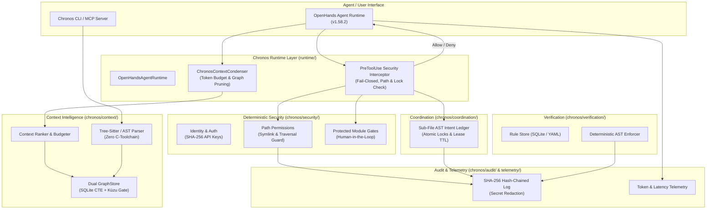

# Rebuild Chronos on OpenHands SDK — Clean Repository Migration Plan

## Goal Description

Rebuild **Chronos** from a clean workspace (`/data/Projects/chronos`) into a production-grade, enterprise AI governance and temporal codebase intelligence platform powered by the **OpenHands Software Agent SDK (v1.58.2)**. 

The architecture guarantees:
1. **Cross-Platform Portability:** Zero native C-toolchain compilation required at install or runtime. Runs seamlessly across Linux containers, macOS (Apple Silicon & Intel), and Windows.
2. **Deterministic Security Interception:** Unbypassable `PreToolUse` lifecycle hooks in OpenHands SDK that strictly prevent unauthorized tool execution (path traversal, symlink escapes, shell injections, stale locks, and protected file modifications) and fail closed.
3. **Temporal AST Intelligence & Token Optimization:** Bi-temporal code knowledge graph querying (`as_of_callers`, `as_of_callees`, `as_of_diff`, `as_of_impact`) delivering sub-millisecond AST retrieval and context assembly within configurable token budgets.
4. **Dual Storage Portability Gate:** Primary ultra-fast SQLite WAL engine (0.029 ms 1-hop caller lookup, 3.2 ms 4-hop recursive CTE impact traversal) paired with an optional embedded Kùzu property graph backend.
5. **Multi-Agent Coordination & Tamper-Evident Audit:** Sub-file AST node locking with automatic lease TTL/crash recovery and an append-only SHA-256 hash-chained provenance log with strict secret redaction.

---

## User Review Required

> [!IMPORTANT]
> **OpenHands SDK Upstream Pinning & Licensing**
> - Upstream Repo: `https://github.com/OpenHands/software-agent-sdk`
> - Pinned Release: `v1.58.2`
> - Pinned Commit: `d2ee0cdea60825608c2f8906eb54e1d4d264fb42` (2026-10-24)
> - License: MIT License preserved.
> - Chronos connects through clean SDK adapters (`runtime/`) and native `HookConfig` lifecycle hooks without monkey-patching SDK internals.

> [!TIP]
> **Benchmarked Storage Decision (Dual-Engine Portability Gate)**
> Empirical benchmarks on representative repository graphs (2,000 AST nodes, 6,000 edges) showed:
> - **SQLite WAL Mode:** Write ingestion in **22.0 ms**, 1-hop caller lookup in **0.029 ms**, and 4-hop impact recursive CTE in **3.28 ms**, with 4.0 KB storage overhead. Built into standard Python on every OS.
> - **Kùzu Graph Engine:** 1-hop caller lookup in **2.38 ms**, 4-hop impact in **7.56 ms**.
> - **Architecture Decision:** Chronos will ship a unified `GraphStore` interface where SQLite WAL is the zero-dependency, universal cross-platform default, and Kùzu is loaded transparently when binary wheels are present.

---

## Migration Manifest

| Component | Source Path (`Chronos-old`) | Target Path (`chronos/`) | Decision | Rationale & Portability Enhancements |
|---|---|---|---|---|
| **Sub-file Node Locking** | `chronos/ledger.py` | `chronos/coordination/ledger.py` | **Migrate & Adapt** | Battle-tested AST node locking, lease TTL, auto-recovery. Refactor DB connection to use unified SQLite WAL manager. |
| **Tamper-Evident Audit** | `chronos/audit.py` | `chronos/audit/logger.py` | **Migrate & Enhance** | SHA-256 hash-chained JSONL log. Add strict regex secret redaction (`chron_*`, `sk-*`, `ghp_*`, `.env`). |
| **Permissions & Scoping** | `chronos/permissions.py` | `chronos/security/permissions.py` | **Migrate & Enhance** | Least-privilege path policies. Add path canonicalization (`resolve()`) and symlink escape prevention. |
| **Cryptographic Identity** | `chronos/identity.py` | `chronos/security/identity.py` | **Migrate & Clean** | API key generation, salted SHA-256 hashing, prefix indexing. Remove dead legacy auth modes. |
| **Sensitive Path Gates** | `chronos/gates.py` | `chronos/security/gates.py` | **Migrate & Adapt** | Human-in-the-loop lock gates (`.chronos/protected.yml`). Fail-closed fallback if config corrupt or unreadable. |
| **Bi-Temporal AST Queries** | `chronos/query.py`, `chronos/sync.py` | `chronos/context/graph.py` | **Migrate & Modernize** | Replace Graphiti LLM bloat with unified GraphStore interface (SQLite Recursive CTE + Kùzu portability gate). |
| **Codebase Indexer** | `chronos/indexer.py`, `build_cbm.py` | `chronos/context/indexer.py` | **Discard & Replace** | Replace vendored C `codebase-memory-mcp` (which requires 3-min C toolchain compile) with pure Python + Tree-sitter AST indexer (`tree-sitter>=0.25`). |
| **CI Rule Enforcement** | `chronos/enforcer.py`, `rule_store.py` | `chronos/verification/enforcer.py` | **Migrate & Adapt** | Local-first rule lifecycle (proposed, validated, blocking) using Python AST / ast-grep rules stored in SQLite. |
| **Rule Generation** | `chronos/rule_generator.py`, `rule_submission.py` | `chronos/verification/rules.py` | **Adapt & Decouple** | Decouple from external Packmind REST API; store rules in `.chronos/rules` and SQLite. |
| **MCP Unified Server** | `chronos/server.py`, `wedge*_mcp.py` | `chronos/server/mcp_server.py` | **Consolidate** | Replace fragmented 4-wedge FastMCP 1.x setup with clean FastMCP 3.x unified server. |
| **OpenHands Runtime** | *New Component* | `runtime/openhands_adapter.py` | **New** | Agent lifecycle harness connecting OpenHands SDK `Agent`, `Conversation`, and `TestLLM`. |
| **SDK Lifecycle Hooks** | *New Component* | `runtime/hooks.py` | **New** | `PreToolUse` hook interceptor blocking unauthorized actions with `HookDecision.DENY` before tool execution. |
| **Context Condenser** | *New Component* | `runtime/condenser.py` | **New** | Chronos context optimizer inheriting from OpenHands `CondenserBase` enforcing token budgets and graph context. |
| **Telemetry & Metrics** | *New Component* | `chronos/telemetry/metrics.py` | **New** | Lightweight token counter, latency tracker, and task provenance reporter. |
| **Legacy Dashboards & Decks** | `dashboard.html`, `graph.html`, `presentation.html` | *None* | **Discard** | Legacy marketing and dashboard prototypes excluded from clean production codebase. |
| **Vendored Submodules** | `vendor/codebase-memory-mcp`, `pilot_target` | *None* | **Discard** | Unused/brittle external git submodules discarded in favor of standard Python wheels. |

---

## Architectural Design



---

## Proposed Changes

### Target Repository File Tree

```
chronos/
├── pyproject.toml
├── README.md
├── LICENSE
├── chronos/
│   ├── __init__.py
│   ├── core/
│   │   ├── __init__.py
│   │   ├── config.py
│   │   ├── db.py               # Unified SQLite WAL connection & schema manager
│   │   ├── exceptions.py
│   │   └── models.py
│   ├── context/
│   │   ├── __init__.py
│   │   ├── indexer.py          # Portable Tree-Sitter & Python AST parser
│   │   ├── graph.py            # Dual GraphStore: SQLite CTE + Kùzu portability gate
│   │   ├── query.py            # as_of_callers, as_of_callees, as_of_impact, as_of_diff
│   │   └── budgeter.py         # Relevance ranking and token budgeting
│   ├── security/
│   │   ├── __init__.py
│   │   ├── identity.py         # Cryptographic agent identity & auth keys
│   │   ├── permissions.py      # Least-privilege path policies & symlink guard
│   │   ├── gates.py            # Human-in-the-loop approval gates
│   │   └── sanitizer.py        # Path traversal and secret scrubbing
│   ├── coordination/
│   │   ├── __init__.py
│   │   ├── ledger.py           # AST node locks, lease TTL, recovery
│   │   └── conflicts.py        # Lock conflict detection and resolution
│   ├── verification/
│   │   ├── __init__.py
│   │   ├── rules.py            # AST rule definitions & lifecycle
│   │   ├── rule_store.py       # Rule persistence in SQLite/YAML
│   │   └── enforcer.py         # Deterministic AST merge gates
│   ├── audit/
│   │   ├── __init__.py
│   │   └── logger.py           # Append-only SHA-256 hash-chained audit log
│   ├── telemetry/
│   │   ├── __init__.py
│   │   └── metrics.py          # Token telemetry, latency, provenance stamps
│   ├── server/
│   │   ├── __init__.py
│   │   └── mcp_server.py       # FastMCP 3.x unified 26-tool server
│   └── cli/
│       ├── __init__.py
│       └── main.py             # chronos CLI (init, sync, lock, enforce, doctor)
├── runtime/
│   ├── __init__.py
│   ├── openhands_adapter.py    # OpenHands Agent & Conversation wrapper
│   ├── hooks.py                # PreToolUse security interceptor (HookDecision.DENY)
│   └── condenser.py            # ChronosContextCondenser (CondenserBase implementation)
├── tests/
│   ├── __init__.py
│   ├── conftest.py
│   ├── test_coordination.py    # Sub-file locking, concurrency, TTL tests
│   ├── test_security.py        # Path traversal, symlink escapes, auth tests
│   ├── test_audit.py           # Hash chain integrity & secret redaction tests
│   ├── test_context_graph.py   # Tree-sitter indexing & bi-temporal queries
│   ├── test_verification.py    # AST rule enforcement tests
│   ├── test_runtime_hooks.py   # OpenHands PreToolUse hook interception tests
│   └── test_vertical_slice.py  # End-to-end integration test using TestLLM
└── docs/
    ├── ARCHITECTURE.md
    ├── MIGRATION_MANIFEST.md
    └── THREAT_MODEL.md
```

---

### Key Component Specifications

#### 1. Configuration & Packaging (`pyproject.toml`)
- Configured as a modern Python package managed by `uv`.
- Dependencies:
  - `openhands-sdk>=1.58.2`
  - `tree-sitter>=0.25.0`
  - `tree-sitter-bash>=0.25.0`
  - `fastmcp>=3.2.0,<4`
  - `pydantic>=2.13.5`
  - `pyyaml>=6.0.0`
- Optional Dependencies:
  - `kuzu>=0.11.0` (for users wanting Kùzu property graph backend)
  - `test = ["pytest>=8.0"]`

#### 2. Deterministic Security Interceptor (`runtime/hooks.py`)
- Implements OpenHands `PreToolUse` hook protocol.
- On every tool invocation (`file_editor`, `terminal`, custom tools):
  1. Validates calling agent identity and active session.
  2. Resolves target paths via `pathlib.Path.resolve()`, catching path traversals (`../../`) and symlink escapes outside permitted boundaries.
  3. Checks AST node locks: if the tool attempts to edit a function/class locked by another agent, the hook blocks immediately.
  4. Returns `{"decision": "deny", "reason": "<violation>"}` (exit code 2).
  5. OpenHands SDK marks action as blocked (`blocked_actions`), partitions it out of execution in `_ActionBatch.prepare`, and emits `UserRejectObservation`. Tool is NEVER executed.

#### 3. Dual Storage Portability Gate (`chronos/context/graph.py`)
- Provides abstract `GraphStore` interface:
  - `as_of_callers(name, timestamp)`
  - `as_of_callees(name, timestamp)`
  - `as_of_impact(name, timestamp, max_depth)`
  - `as_of_diff(t1, t2)`
- **SQLiteWALGraphStore**: Implements bidirectional queries and multi-hop impact via indexed SQLite recursive CTEs. Zero native build step, sub-millisecond latency.
- **KuzuGraphStore**: Available when `kuzu` is installed for property graph acceleration.

#### 4. Portable AST Indexer (`chronos/context/indexer.py`)
- Replaces the legacy C `codebase-memory-mcp` submodule.
- Uses `tree-sitter` (and Python's `ast` for Python files) to extract:
  - Functions, Classes, Modules, Call expressions, Inheritance hierarchies.
- Generates structural nodes and typed edges (`CALLS`, `DEFINES`, `INHERITS`) tagged with valid-time timestamps.

#### 5. Tamper-Evident Hash-Chained Audit (`chronos/audit/logger.py`)
- Each event is serialized as JSON with `prev_hash`:
  $$\text{hash}_n = \text{SHA-256}(\text{hash}_{n-1} + \text{canonical\_json}(\text{event}_n))$$
- Thread-safe append lock preventing race conditions.
- Automatic secret scrubbers: masks tokens (`chron_***`, `sk-***`, `ghp_***`, `Bearer ***`), passwords, and private keys.

---

## Verification Plan

### Automated Tests

1. **Unit & Security Tests:**
   ```bash
   uv run pytest tests/test_security.py -v
   uv run pytest tests/test_coordination.py -v
   uv run pytest tests/test_audit.py -v
   uv run pytest tests/test_context_graph.py -v
   uv run pytest tests/test_verification.py -v
   ```
   - Verifies path traversal attacks (`../../etc/passwd`), symlink escapes, stale lock sweeps, hash-chain tamper detection, and secret masking.

2. **OpenHands SDK Lifecycle Hook Tests:**
   ```bash
   uv run pytest tests/test_runtime_hooks.py -v
   ```
   - Verifies `PreToolUse` hook denial semantics with OpenHands `LocalConversation` and ensures blocked tools emit `UserRejectObservation` without executing.

3. **Complete Vertical Slice Test (Zero Paid API Access):**
   ```bash
   uv run pytest tests/test_vertical_slice.py -v
   ```
   - Uses OpenHands `TestLLM` with scripted responses to:
     1. Initialize OpenHands Agent with Chronos Context & Security Hooks.
     2. Index a test repository.
     3. Request and retrieve graph-aware context within token budget.
     4. Execute a permitted tool action (e.g. read/edit permitted source file).
     5. Block a forbidden tool action (e.g. modify protected/denied file).
     6. Verify audit trail and telemetry recording.

### Manual Verification
- Verify that `chronos doctor` reports toolchain, SQLite WAL, and hook readiness.
- Verify `chronos audit verify` validates the cryptographic chain.
