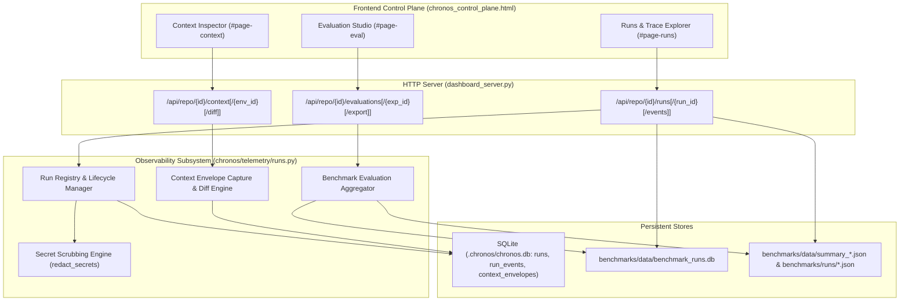

# Chronos Observability Suite — Architecture & Implementation Plan

This document details the implementation plan for the **Chronos Observability Suite**, incorporating three production capabilities:
1. **Runs & Trace Explorer**
2. **Context Inspector**
3. **Evaluation Studio**

---

## 1. Subsystem Architecture Map

---

## 2. Feature 1: Runs & Trace Explorer

### 2.1 Persistent Schema (`chronos/core/db.py`)
- **`runs` table**:
  - `run_id TEXT PRIMARY KEY`: Unique run identifier (e.g. `chronos_task_01_treatment_iter1_6c8396` or `run_...`).
  - `repo_id TEXT NOT NULL`: Associated repository ID.
  - `task_id TEXT`: Benchmark or agent task ID.
  - `task_description TEXT`: Task prompt or objective.
  - `commit_sha TEXT`: Git commit SHA when available.
  - `agent_id TEXT`: Agent identifier.
  - `model_id TEXT`: Resolved LLM model (e.g. `gemini-3.8-flash-medium`, `CodeScout-1.7B`).
  - `provider_name TEXT`: Provider (e.g. `agy`, `openhands`).
  - `arm TEXT`: `treatment` (Chronos enabled) or `baseline` (Chronos disabled).
  - `suite TEXT`: `efficacy`, `security`, `localization`, or custom.
  - `status TEXT NOT NULL DEFAULT 'RUNNING'`: `SUCCESS`, `FAILED`, `CANCELLED`, `RUNNING`.
  - `started_at TEXT NOT NULL`: ISO 8601 UTC timestamp.
  - `ended_at TEXT`: ISO 8601 UTC timestamp.
  - `duration_seconds REAL`: Total execution duration in seconds.
  - `prompt_tokens INTEGER DEFAULT 0`: Input tokens.
  - `completion_tokens INTEGER DEFAULT 0`: Output tokens.
  - `total_tokens INTEGER DEFAULT 0`: Total token consumption.
  - `cost_usd REAL`: Cost in USD (when available).
  - `error_message TEXT`: Summary error description if failed.
  - `metadata TEXT DEFAULT '{}'`: Serialized JSON metadata (tool call counts, patch diff summary, etc.).

- **`run_events` table**:
  - `event_id TEXT PRIMARY KEY`: Unique event ID.
  - `run_id TEXT NOT NULL REFERENCES runs(run_id) ON DELETE CASCADE`.
  - `seq INTEGER NOT NULL`: Monotonically increasing sequence number (1, 2, 3...).
  - `timestamp TEXT NOT NULL`: ISO 8601 UTC timestamp.
  - `event_type TEXT NOT NULL`: Canonical event types:
    - `run_started`
    - `intent_resolution`
    - `file_retrieval`
    - `symbol_retrieval`
    - `memory_retrieval`
    - `memory_injection`
    - `context_envelope_created`
    - `tool_invocation`
    - `tool_completion`
    - `lease_acquisition`
    - `lease_release`
    - `lease_conflict`
    - `policy_decision`
    - `file_modification`
    - `test_execution`
    - `retry`
    - `run_completed`
    - `run_failed`
  - `payload TEXT NOT NULL DEFAULT '{}'`: Sanitized JSON payload.

### 2.2 Security & Secret Scrubbing
All event payloads pass through `chronos.security.sanitizer.redact_secrets` before insertion into `run_events` or `runs`.

---

## 3. Feature 2: Context Inspector

### 3.1 Context Envelope Schema (`chronos/core/db.py`)
- **`context_envelopes` table**:
  - `envelope_id TEXT PRIMARY KEY`: `ctx_<hex>` identifier.
  - `run_id TEXT`: Associated run ID (if run context).
  - `repo_id TEXT NOT NULL`: Associated repository ID.
  - `prompt TEXT NOT NULL`: Natural language query or directive.
  - `commit_sha TEXT`: Git revision.
  - `token_budget INTEGER`: Requested token ceiling.
  - `estimated_tokens INTEGER`: Token estimator count.
  - `actual_tokens INTEGER`: Exact token count.
  - `resolved_files TEXT DEFAULT '[]'`: JSON list of selected target files.
  - `resolved_symbols TEXT DEFAULT '[]'`: JSON list of selected symbol seeds.
  - `test_files TEXT DEFAULT '[]'`: JSON list of co-located test suites.
  - `candidates TEXT DEFAULT '[]'`: Ranked candidate evidence with weights & signals:
    - `node_id`, `name`, `path`, `kind`, `score`, `signals`, `source`.
  - `memory_entries TEXT DEFAULT '[]'`: Injected epistemic memories with tier and provenance.
  - `graph_expansion TEXT DEFAULT '{}'`: Callers, callees, and dependency tree.
  - `exclusions TEXT DEFAULT '[]'`: Pruned candidates due to budget or score cutoff with rationale.
  - `provenance_summary TEXT`: Human-readable summary.
  - `mode TEXT`: Retrieval engine mode.
  - `created_at TEXT NOT NULL`: ISO 8601 UTC.

### 3.2 Context Diffing
- `GET /api/repo/{id}/context/diff?base={id1}&target={id2}` computes:
  - File additions, removals, retentions.
  - Symbol additions, removals.
  - Candidate score deltas.
  - Token budget utilization delta.

---

## 4. Feature 3: Evaluation Studio

### 4.1 Benchmark Integration
- Uses canonical `benchmarks/data/benchmark_runs.db` and `benchmarks/data/summary_*.json`.
- Aggregates paired tasks (e.g. 23 paired benchmark tasks).
- Computes:
  - Task success rate (baseline vs treatment, McNemar p-value, 95% bootstrap CI).
  - Mean/median token reduction (reconciling canonical 59.56% and DB 61.03%).
  - Latency: p50 (median), p95, and mean.
  - Tool calls attempted and allowed.
  - Security blocks pre-execution.
  - Localization Recall@5 and Recall@10 when available.
  - Per-task regression detection: flags tasks that succeeded in baseline but regressed in treatment.

### 4.2 Export
- Provides `GET /api/repo/{id}/evaluations/{exp_id}/export?format=csv|json`.

---

## 5. Verification Plan
- Unit and integration tests in `tests/test_observability.py`.
- Regression testing of all 16 existing UI server tests in `tests/test_ui_server.py`.
- Full Chronos suite verification.
